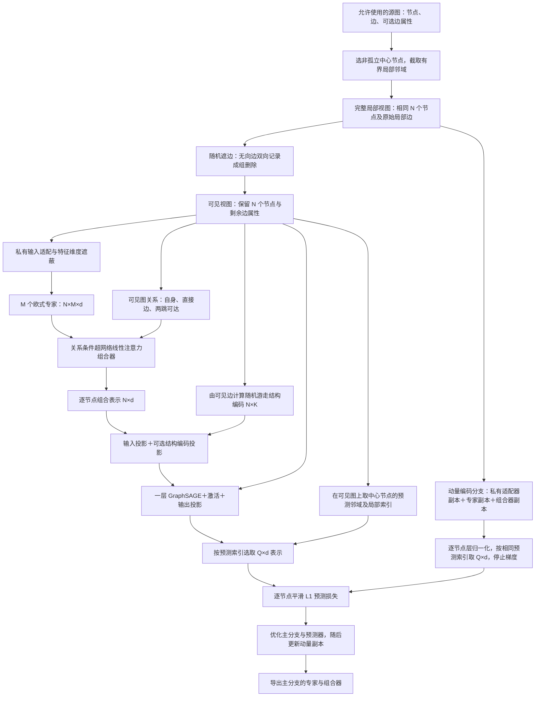

# FedG2C 第一阶段：关系条件专家组合学习

更新：2026-10-09。默认预测器已改为一层 GraphSAGE，Transformer 保留为对照。当前实现为 `edge_prediction`；旧区域池化原型保留为 `legacy_pool`，原 Gefra 代码保留。本文区分**已实现机制、公开来源、图适配选择和仍需验证的假设**。项目入口与整体职责见 [总览](README_FedG2C.md)。

## 1. 总体思路与目的

我们希望共享模型不仅包含多个专家，还能利用图中的局部关系组合专家表示，使组合规则有机会迁移到新的结构组合与下游任务。客户端对局部图随机遮边，并按特征类型在私有输入适配前或后遮蔽通道，再由欧式专家和关系条件组合器得到逐节点表示；预测器根据可见图的结构位置，预测局部邻域内各节点在完整局部图上的参考表示。参考表示由主编码分支的动量副本提供，不使用分类标签。

这里的**联合嵌入预测**提供预训练信号，**关系条件专家组合**是我们要研究的共享能力。结构位置编码与输入遮蔽服务于这个训练任务，不作为独立的新贡献。参考分支采用指数移动平均（Exponential Moving Average，EMA）更新；它是本地训练辅助副本，最终共享模型仍指专家与组合器，不采用“学生模型”命名。**主编码分支**就是接收梯度、由优化器直接更新的分支；旧代码中的 `online` 对应这一含义，当前新增实现改为 `main_branch`。

此任务促进“受扰动输入下的表示预测”，但**不能仅凭该损失断言学到了组合泛化**。是否改善未见结构组合、是否优于单专家与线性门控，需要正式组合留出实验及后续阶段验证。预训练接口输出逐节点表示，可服务于非分子节点任务，也可经下游按图池化服务于分子和非分子图任务。

## 2. 这次采用什么现有依据

| 具体选择 | 论文与官方来源 | 借用范围与适配边界 |
|---|---|---|
| 潜表示预测、停止梯度参考、动量更新 | （可见上下文）[I-JEPA，CVPR 2023](https://openaccess.thecvf.com/content/CVPR2023/html/Assran_Self-Supervised_Learning_From_Images_With_a_Joint-Embedding_Predictive_Architecture_CVPR_2023_paper.html)；[官方实现](https://github.com/facebookresearch/ijepa) | 沿用训练机制；当前预测器使用 GraphSAGE，不再沿用图像位置查询。旧 Transformer 预测器作为对照保留，不声称复现整篇论文。 |
| 随机遮边＋随机特征维度遮蔽 | [BGRL，ICLR 2022 论文与官方代码入口](https://github.com/nerdslab/bgrl) | 借用输入扰动，不照搬其双向增强视图损失。本文主分支扰动，参考分支使用完整局部视图。 |
| 随机游走结构编码 | [GraphGPS，NeurIPS 2022](https://proceedings.neurips.cc/paper_files/paper/2022/hash/5d4834a159f1547b267a05a4e2b7cf5e-Abstract-Conference.html)；[官方实现](https://github.com/rampasek/GraphGPS) | 迁移返回概率计算到有界局部图；作为预测器的结构条件，不移植整套 GraphGPS。 |
| 专家之间的非线性组合 | （关系条件超网络线性注意力组合器）[Attention as a Hypernetwork，ICLR 2025](https://proceedings.iclr.cc/paper_files/paper/2025/hash/abfa542f546df3c6c35695ec8d5bf4b9-Abstract-Conference.html)；[官方实现](https://github.com/smonsays/hypernetwork-attention) | 沿用已有头维归一化和两次收缩核心。图关系偏置与节点×专家布局是本项目适配；本轮未改动该核心。 |
| 图编码与客户端生命周期 | 自有 Gefra 的 `model/graph_encoders.py` 与客户端 set/pretrain/get 接口 | 复用欧式图编码器和调用边界；原始文件不覆盖、不删除；新路径不导入几何专家。 |

**Graph-JEPA 不再作为当前实现依据，也不保留双曲预测目标。** 旧文档和旧实现作为历史版本保存。局部邻域选择、类别特征遮蔽位置以及有界视图大小，是为适配本项目接口作出的选择，不能归为上述论文已经验证的结果。

### 2.1 对“只遮边、保留特征”的处理

随机遮边本身是已有图自监督做法，例如 [MaskGAE，KDD 2023 的官方实现](https://github.com/EdisonLeeeee/MaskGAE) 通过结构重构训练。它与这里的潜表示预测任务不同，不能据此推断我们的模型不会利用特征捷径。

本版采用 BGRL 已有的“遮边＋特征维度遮蔽”作为起点，保留 `feature_mask_rate=0` 的只遮边对照。不引入额外的反捷径损失，也不把遮蔽声称为消除捷径的保证。它降低原始特征完全可见的程度；组合泛化收益仍需实验。

BGRL 官方 `DropFeatures.__call__` 为每个特征维度抽一次掩码，在同一视图所有节点上共用，置零但不进行反向概率缩放。本版连续特征遵循这一做法。类别编号中的 0 常是有效类别，所以类别输入先进行私有嵌入，再遮蔽嵌入通道；这是显式的类别输入适配。

### 2.2 初始配置的依据与限制

[配置文件](config/fedg2c_edge_prediction.json) 的遮边率 0.5、特征遮蔽率 0.2，取自 BGRL 官方 [Amazon Computers 配置的第一个视图](third_party_references/bgrl/config/amazon-computers.cfg)。这只是有公开出处的运行起点，**不是分子任务或所有图任务的公认最优值**。其 [Coauthor CS 配置](third_party_references/bgrl/config/coauthor-cs.cfg) 使用不同强度，也表明增强率需要按数据设定。

隐藏维度 64、4 个专家、2 层图编码、最多 32 节点、2 跳上下文、1 跳预测邻域、随机游走步数 1–8、一层 GraphSAGE 预测器、固定动量 0.99 是可调工程配置，不宣称来自同一篇论文的完整推荐配置。I-JEPA 的原训练设置含动量调度，本地短训练目前采用固定动量。正式数据运行必须显式传入配置；只有合成检查自动读取这个起点配置。

## 3. 详细数据流

符号：局部节点数为 N，输入特征维度为 F，共享隐藏维度为 d，专家数为 M，预测节点数为 Q，随机游走步数个数为 K。一次前向只处理一个局部图，不在不同图之间建立注意力。



### 3.1 取上下文与预测区域

1. 输入必须是符合源数据使用协议的图。以具有非自环邻居的节点为中心，默认选取最多 32 节点的 2 跳邻域。超过容量时随机截断当前扩展层；不从其他连通分量补足节点。
2. 上一步得到完整**局部**参考视图，并非整张大图。随机删除其中的边形成可见视图，两者节点集合和排列相同。无向输入必须同时存储两个方向，采样时双向边及重复记录成组保留或删除；对应边属性同步筛选。有向数据使用 `undirected=false`，保留原有方向。
3. 预测区域由可见视图中中心节点默认 1 跳邻域定义，每个节点分别预测。区域选择的遍历把相邻关系视为无向，但实际消息传递、关系特征和随机游走保留输入方向。若遮边使中心孤立，预测区域退化为中心节点本身。
4. 预测索引仅用于对齐两分支的同一节点，不将原始节点编号作为模型特征。每步重新采样中心、边掩码和特征掩码。

**“预测区域”不意味着该区域的全部节点信息不可见。** 当前隐藏的是部分边与特征通道，节点仍在主分支中。它是受扰动图上的表示预测，与 I-JEPA 在图像中删除预测块的输入方式有差异。没有把被删边变成分类标签，也没有负边采样、邻接重构头。

边遮蔽遵循随机采样，允许某个小视图偶然一条边未删或全部边被删；代码不偷偷重采样以保证难度。完全没有非自环边的源图明确报错，需要数据准备时说明处理方式。`max_nodes` 仅限制单次模型视图，源张量文件仍需能被读取到内存。

### 3.2 私有适配器与特征遮蔽

| 输入类型 | 主分支处理顺序 | 完整局部参考分支 |
|---|---|---|
| 连续节点特征 `[N,F]` | 在原始 F 个通道上共享一个随机掩码，再线性投影到 d 维 | 原始特征直接经动量适配器 |
| 类别节点特征 `[N,F]` | 按显式类别数逐列嵌入并求和，在 d 个嵌入通道上遮蔽 | 原类别编号经动量适配器，不遮蔽 |
| 可选边属性 | 删除边时同步筛选属性，然后经私有边适配器进入专家 | 完整局部边属性经动量边适配器 |

特征遮蔽不修改源张量，不改变类别编号，不自动遮蔽边属性通道。当前有边属性时要求 `mysage`，利用 Gefra 的 `EdgeAwareSAGEConv`。已有新增子类解决原 `GraphEncoder.encode` 未传边属性的问题，原文件保持不变。

### 3.3 专家与关系条件组合

私有适配后的输入 `[N,d]` 分别进入 M 个欧式专家，产生 `[N,M,d]`。组合器将它展开为 N×M 个 token，计算查询、键和值。可见图的三个关系通道为自身、直接有向边、两步可达；线性映射得到逐头关系偏置，与内容相似度相加。具体为单位矩阵、二值邻接矩阵 A，以及 `(A @ A > 0)`，不是互斥的最短距离类别。两步通道允许走回自身，也可能与直接边通道重叠。

组合器按头维进行均方根归一化，然后执行“条件编码与值的收缩→非线性激活→再次用条件编码收缩”。残差与层归一化后，**只在同一节点的专家轴上求平均**，得到 `[N,d]`。这里没有把预测区域的节点轴池化成单个向量。内容相似度和关系偏置共同形成条件组合编码，对应本实现中承担路由作用的部分；它不执行原 Gefra 的稀疏 Top-K 专家选择。

“超网络线性注意力”沿用模块名称，但当前实现显式计算局部 token 两两分数，不能据名称宣称对节点数具有线性复杂度。专家数和视图上限直接影响开销。

### 3.4 预测器如何知道预测哪里

在**遮边后的局部图**构造转移矩阵 `T=D_out^{-1}A`，取各步返回概率 `diag(T^k)`，得到随机游走结构编码（Random Walk Structural Encoding，RWSE）。孤立节点对应零行，不人为补自环；重复边在结构统计中按单条边处理，消息传递仍保留输入记录。这是对 GraphGPS 函数的无权简单图适配。

当前采用 **局部上下文预测器**：先将组合后的节点表示投影到预测器维度，可选地加上结构编码投影，然后通过一层 PyG `SAGEConv`（均值聚合、保留自身项）、ReLU 和输出线性层，得到 `[N,d]`，最后按预测索引选择 `[Q,d]`。预测器只读取可见 `edge_index`，不要求边属性，不读取参考分支的完整边。

输出第 i 行始终对应输入第 i 个节点，预测索引只负责对齐，原始节点编号不进入模型。当前保留节点、遮蔽边和特征，因此预测器可以读取预测节点自身的受扰动表示。没有再次将整个预测区域的组合表示清零；这是与 GraphMAE 再遮蔽解码的明确差异。

结构编码仍每次由遮边后的图计算，作为可关闭的补充输入。`position_encoding=none` 不影响节点对齐；当前开关只让预测器忽略结构编码，`NodewisePredictionModel.forward` 仍会计算随机游走编码，因此不能据此报告省掉了该部分计算开销。相同结构编码不再必然导致相同预测，因为节点组合表示和邻居表示也进入计算；结构与属性都对称时，仍不保证可区分。

来源分为两层：GraphMAE（KDD 2022）提供浅层图解码器的设计参考，但其任务是特征重构；GraphSAGE（NeurIPS 2017）提供具体聚合操作，直接调用 PyG 库。将它用于动量潜表示预测是本项目适配，不能宣称已有论文已验证这套完整组合。预测器显式聚合限于一跳可见邻居，不能视为原 Transformer 全局注意力的数值等价替代；上游组合表示仍可包含更广的上下文。

`--predictor transformer` 保留原查询式预测器对照。其相同结构查询产生相同确定性输出的限制仅针对该旧查询形式。`predictor_heads` 与 `predictor_depth` 仅用于 Transformer；GraphSAGE 固定一层，使用 `predictor_dim`。

### 3.5 参考表示、损失与更新顺序

完整局部图输入动量编码分支，得到 `[N,d]` 表示；对每个节点独立进行层归一化，按预测索引取 `[Q,d]`，并停止梯度。主分支输出同样形状的预测表示，使用平滑 L1 损失对所有预测节点和特征维度取平均。

优化器更新主分支的私有适配器、共享专家、共享组合器和本地预测器。随后执行 `动量参数 ← m×动量参数 + (1−m)×主分支参数`。动量分支始终处于推理模式，不参与反向传播；它也不包含预测器。每次接收新共享参数时同步重置动量副本，避免跨轮保留与新基座不一致的参考模型；独立入口 `pretrain_fedg2c.py` 只做本地训练；`pretrain_federated_fedg2c.py` 已执行多轮下发、本地训练和服务器聚合。联邦轮次间保留私有适配器及预测器参数，重置动量副本和本地优化器。

目前使用 AdamW，每次 `pretrain` 调用新建优化器；梯度范数裁剪阈值 5 沿用已有新增训练器设置。这些是实现设置，不属于论文贡献。

## 4. 伪代码

```text
输入：允许使用的源图集合、共同初始化的共享专家与组合器、私有特征编码规范
创建主编码分支 = 私有输入适配器 + 共享专家 + 共享组合器
创建动量编码分支 = 主编码分支的不可训练副本
创建本地逐节点预测器

每次本地训练调用：
    新建优化器
    对每张源图及每次局部采样：
        完整局部图 = 从非孤立中心取有界上下文邻域
        可见局部图 = 随机删除边，保留相同节点；同步筛选边属性
        预测索引 = 可见图中该中心的局部邻域
        特征掩码 = 对通道独立采样，同一视图所有节点共用
        可见表示 = 主编码分支(可见局部图, 特征掩码)
        结构位置 = 随机游走返回概率(可见局部图)
        预测表示 = 本地预测器(可见表示, 结构位置, 预测索引, 可见边)
        无梯度：
            全部参考表示 = 动量编码分支(完整局部图, 不遮蔽特征)
            参考表示 = 逐节点层归一化(全部参考表示)[预测索引]
        损失 = 平滑L1(预测表示, 参考表示)
        反向传播 → 梯度裁剪 → 优化器更新
        指数移动平均更新动量编码分支
        记录损失、遮蔽量、预测节点数和表示标准差
    返回主编码分支中的专家参数与组合器参数
```

## 5. 具体代码接点与迁移内容

旧 `fedg2c/model.py::LocalPredictionModel` 等保留，当前逐节点设计通过独立文件接入。以下说明每个函数的作用、来源和适配范围。

| 文件与函数 | 本次作用 | 依据和修改性质 |
|---|---|---|
| [pretrain_fedg2c.py](pretrain_fedg2c.py) `main` | 新增路由块，选择 `edge_prediction` 或 `legacy_pool` | 保留原入口代码，仅插入分派 |
| [fedg2c/edge_entry.py](fedg2c/edge_entry.py) `run` | 配置、清单、客户端循环、保存参数与指标 | 接入自有骨架；本地训练入口，不包含服务器轮次 |
| [fedg2c/edge_config.py](fedg2c/edge_config.py) `EdgePredictionConfig` | 显式增强率、邻域和预测器配置 | 新增独立配置，旧配置不改 |
| [fedg2c/edge_views.py](fedg2c/edge_views.py) `mask_edges`、`sample_feature_keep` | 遮边及共享通道掩码 | 依据 BGRL `DropEdges`、`DropFeatures` 的操作逻辑；独立张量实现，新增成组删除与局部随机生成器 |
| 同文件 `NeighborhoodEdgeSampler.sample_edge_view` | 两个视图、预测邻域及节点对齐 | 本项目图适配；复用已有采样器的校验与邻接缓存，以及 PyG 子图工具 |
| [fedg2c/edge_model.py](fedg2c/edge_model.py) `MaskedEncodingBranch.forward` | 连续或类别输入安全地应用特征遮蔽 | 继承已有私有适配接口；类别嵌入后遮蔽为本项目适配 |
| [fedg2c/structural_encoding.py](fedg2c/structural_encoding.py) `random_walk_encoding` | 可见局部图的返回概率 | 对应 GraphGPS `get_rw_landing_probs`；无权、无尺度修正、有界稠密计算，重复边二值化 |
| [fedg2c/graph_predictor.py](fedg2c/graph_predictor.py) `GraphSAGEPredictor.forward` | 可见邻居聚合→逐节点潜表示 | 直接调用 PyG `SAGEConv`；GraphMAE 浅层解码结构提供参考，潜表示任务为本项目适配 |
| [fedg2c/node_predictor.py](fedg2c/node_predictor.py) `NodeRepresentationPredictor.forward` | 原 Transformer 对照 | 依据 I-JEPA 的序列组织；保留代码，使用显式开关选择 |
| [fedg2c/edge_model.py](fedg2c/edge_model.py) `NodewisePredictionModel.forward/update_momentum/reset_momentum` | 无梯度参考、逐节点归一化、损失及动量更新 | 依据 I-JEPA `train.py` 的训练机制；区域池化被新路径中的逐节点预测替代 |
| [fedg2c/edge_client.py](fedg2c/edge_client.py) `EdgePredictionClient.pretrain/set_pretrain_model/get_pretrain_model/get_local_message` | 本地更新与共享参数边界 | 运行时用 Gefra 形状的命名参数消息；原状态字典接口保留给保存和旧调用；不继承几何客户端 |
| [fedg2c/model.py](fedg2c/model.py) `SharedBackbone/EdgePassingGraphEncoder` | 专家与边特征传递 | 沿用已有新增实现，本轮不改 |
| [fedg2c/composer.py](fedg2c/composer.py) `head_rms/hypernetwork_contract/RelationComposer.forward` | 关系条件非线性组合 | 沿用既有超网络线性注意力适配，本轮不改 |

### 5.1 来源与具体上游函数

- **GraphSAGE**：[NeurIPS 2017 原论文](https://papers.nips.cc/paper_files/paper/2017/hash/5dd9db5e033da9c6fb5ba83c7a7ebea9-Abstract.html)，直接调用 [PyG SAGEConv](https://pytorch-geometric.readthedocs.io/en/latest/generated/torch_geometric.nn.conv.SAGEConv.html)，本次运行库版本为 2.7.0。没有手写其消息传递内核。
- **GraphMAE**：[KDD 2022 官方仓库](https://github.com/THUDM/GraphMAE)，`graphmae/models/edcoder.py` 中的 `PreModel.__init__` 构造一层图解码器，`mask_attr_prediction` 执行逐节点解码。仅参考浅层解码结构，不迁移其重构损失、再遮蔽或完整图解码输入，也没有复制源码。

- **BGRL**：提交 `60f9f19ad0598f9163ad70ebbde3e7297760901e`，[`bgrl/transforms.py`](https://github.com/nerdslab/bgrl/blob/60f9f19ad0598f9163ad70ebbde3e7297760901e/bgrl/transforms.py) 的 `DropFeatures.__call__`、`DropEdges.__call__`、`get_graph_drop_transform`。本地保存于 [参考文件](third_party_references/bgrl/bgrl/transforms.py)，许可证 Apache 2.0。
- **GraphGPS**：提交 `28015707cbab7f8ad72bed0ee872d068ea59c94b`，[`graphgps/transform/posenc_stats.py`](https://github.com/rampasek/GraphGPS/blob/28015707cbab7f8ad72bed0ee872d068ea59c94b/graphgps/transform/posenc_stats.py) 的 `get_rw_landing_probs`。本地保存于 [参考文件](third_party_references/GraphGPS/graphgps/transform/posenc_stats.py)，保留 MIT 许可证。简化的是依赖与支持范围，没有迁移图 Transformer 整体框架。
- **I-JEPA**：提交 `52c1ae95d05f743e000e8f10a1f3a79b10cff048`，[`src/train.py`](https://github.com/facebookresearch/ijepa/blob/52c1ae95d05f743e000e8f10a1f3a79b10cff048/src/train.py) 中参考分支、层归一化、平滑 L1 与优化后动量更新；[`src/models/vision_transformer.py`](https://github.com/facebookresearch/ijepa/blob/52c1ae95d05f743e000e8f10a1f3a79b10cff048/src/models/vision_transformer.py) 的 `VisionTransformerPredictor.forward`。本地参考快照及 CC BY-NC 4.0 许可证保存在 [参考目录](third_party_references/ijepa)。新增实现参考机制独立编写，未复制上游训练脚本或预测器源码；随项目分享的参考快照仍保留其上游许可。
- **超网络线性注意力**：提交 `5dceaa1ebef5187a17a38d477a6b2fee8bc3dc38`，[`hyla/models/attention.py`](https://github.com/smonsays/hypernetwork-attention/blob/5dceaa1ebef5187a17a38d477a6b2fee8bc3dc38/hyla/models/attention.py) 的 `rms_head` 与 `mlp_relu` 分支；既有迁移为 PyTorch 计算核心，MIT 声明在 [third_party_notices](third_party_notices)。没有声称完成 JAX 整层的同权重复现。

本轮参考文件的 URL、提交和 SHA-256 统一记录在 [来源清单](third_party_references/manifest.json)。它们用于检查迁移内容，不加入主程序的 Python 导入路径。

## 6. 启动方式与对照开关

以下命令均在 `FedG2C/` 中执行；输出目录必须不存在。

```bash
# 当前设计，两个合成客户端各三步
python pretrain_fedg2c.py --use-new-design --smoke --max-steps 3 --output runs/edge_smoke_001

# 用已准备好的真实训练数据运行：以下清单路径是示例，须替换
python pretrain_fedg2c.py --use-new-design --local-design edge_prediction \
  --source-manifest data/source_manifest.json --config config/fedg2c_edge_prediction.json \
  --epochs 1 --views-per-graph 1 --output runs/source_run_001

# 仅遮边，对照特征遮蔽的贡献
python pretrain_fedg2c.py --use-new-design --smoke --feature-mask-rate 0 --output runs/edges_only_001

# 无结构位置条件对照
python pretrain_fedg2c.py --use-new-design --smoke --position-encoding none --output runs/no_position_001

# 关闭关系条件，保留内容条件组合
python pretrain_fedg2c.py --use-new-design --smoke --no-relation-condition --output runs/no_relation_001

# 线性门控，必须同时关闭关系分支
python pretrain_fedg2c.py --use-new-design --smoke --composer linear_gate \
  --no-relation-condition --output runs/linear_gate_001

# 历史区域池化原型
python pretrain_fedg2c.py --use-new-design --local-design legacy_pool \
  --smoke --max-steps 3 --output runs/legacy_pool_001

# 原 Gefra 入口；后面传原有参数
python pretrain_fedg2c.py --no-use-new-design --help

```

也支持 `--edge-mask-rate 0`、`--composer hypernetwork_linear`、`--composer standard_attention` 和 `--no-undirected`。配置中的邻域大小、预测器维度与动量可修改。当前新路径只实现潜表示预测，不沿用旧路径的特征回归开关。

### 启动参数用普通话解释

- `--use-new-design`：启用 FedG2C 新路径，而不是原 Gefra。
- `--local-design edge_prediction`：选择当前遮边后的逐节点潜表示预测流程；这是新路径的默认值，可省略。这里不是边分类任务。
- `--predictor graphsage`：使用一层 GraphSAGE，当前默认，可省略；`--predictor transformer` 切回原预测器。
- `--source-manifest data/source_manifest.json`：读取你准备的真实源训练图清单。该路径是示例，不表示项目已准备好 PCBA 或其他真实数据。
- `--config config/fedg2c_edge_prediction.json`：读取增强率和模型设置。
- `--smoke`：自动生成小型合成图检查程序。它与真实源清单二选一。

源清单只是告诉加载器“哪个客户端读哪些文件、如何解释特征”，不创建数据、不进行组合划分、不自动从 PyG 下载数据。原来的“显式选择”只是把默认选项完整写在命令中，没有额外算法含义。

## 7. 数据清单与下游使用边界

```json
{
  "schema_version": 1,
  "protocol_id": "your_audited_source_split_id",
  "clients": [
    {
      "id": "source_0",
      "feature_schema": {"input_dim": 16},
      "graphs": ["allowed_source_graphs.pt"]
    }
  ]
}
```

`graphs` 路径相对源清单文件。每个 `.pt` 为单个张量字典或其列表：`x [N,F]`、长整型 `edge_index [2,E]`、可选 `edge_attr [E,F_edge]` 与 `original_node_id [N]`。类别输入在 `feature_schema` 增加每列的 `node_cardinalities`，边属性增加 `edge_dim`，类别边属性增加 `edge_cardinalities`；必须按真实数据编码器填写。

加载器不读取标签、划分掩码、因素标签或预计算位置编码。它不自动审计组合留出，也不自动导出 PCBA→HIV 数据。对于严格归纳式节点任务，应先构造允许使用的源子图，不能只隐藏测试标签却保留不允许看到的测试结构；若实验允许传导式结构访问，应在协议中单独写清。

## 8. 共享什么、保留什么

| 内容 | 本地训练 | 上传／下游基座 |
|---|---|---|
| 主分支欧式专家 | 梯度更新 | 共享 `experts.*` |
| 主分支关系条件组合器 | 梯度更新 | 共享 `composer.*`，包括关系映射 |
| 源域节点／边适配器 | 梯度更新 | 私有，不上传；下游新建目标域适配器 |
| 本地逐节点预测器及结构位置投影 | 梯度更新 | 不上传，不作为下游分类器 |
| 动量编码分支 | 优化器更新之后取指数移动平均 | 不上传、不用于下游加载 |
| 随机游走编码 | 每个可见局部图重新计算，无可训练参数 | 当前只服务预训练预测器，不额外导出模块 |

独立本地入口为每个客户端输出 `shared_backbone.pt`、`local_training_state.pt` 和 `metrics.json`，根目录输出 `run_metadata.json`。共享状态键沿用此前 FedG2C 原型的专家／组合器命名；独立入口用 `local_design=edge_prediction` 和元数据版本 2 记录训练语义。联邦入口的各轮客户端只保存共享状态与指标，最后另存每客户端私有模型快照；其上传元数据当前不包含 `local_design` 与 `shared_schema_version`，不能把独立入口的全部元数据字段视为所有入口均有。`local_training_state.pt` 保存模型权重，**不含优化器与随机数状态，不是精确断点续训快照**。新元数据不保存加载器解析后的机器绝对路径，源清单来源记录用于追溯，不应直接当作恢复训练清单。

模块 B 已实现随机块模型结构、标准差为 1 的高斯节点特征探针，以及输出和关系响应匹配聚合。原本地入口仍只运行模块 A；使用新增联邦入口连接 A 与 B。第三阶段已实现低秩适应、残差适配器与可学习提示三个独立对照，并按节点或图任务设置读出。它们与本地联合嵌入预测辅助模块的去留见 [模块 B 设计](02_服务器聚合_关系响应保持.md) 和 [下游组合适配](03_下游微调_组合适配.md)。

## 9. 研究边界与未完成事项

真实源数据准备、GPU 运行、长期训练稳定性与真实下游实验仍需完成。潜表示预测损失本身不能证明组合泛化或避免表示塌缩；需在明确的数据协议下开展组合留出与消融实验。历史方案见 [区域池化原型文档](docs/archive/01_本地预训练_v1_区域池化原型.md)。

当前联邦入口使用 `get_local_message()` 生成 `num_samples/weight` 上传消息，`set_pretrain_model()` 接受命名参数列表下发；独立本地入口仍可传入状态字典。上传只包含共享专家与组合器。详细消息格式、磁盘版本检查及兼容范围见 [服务器设计第 3 节](02_服务器聚合_关系响应保持.md#3-输入输出和共享边界)。
