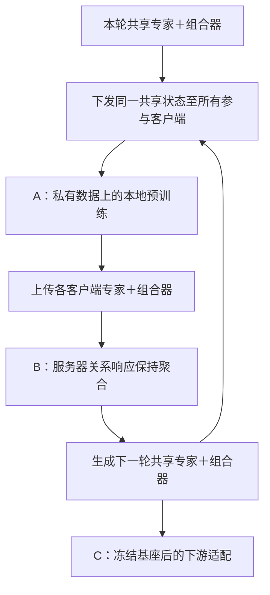
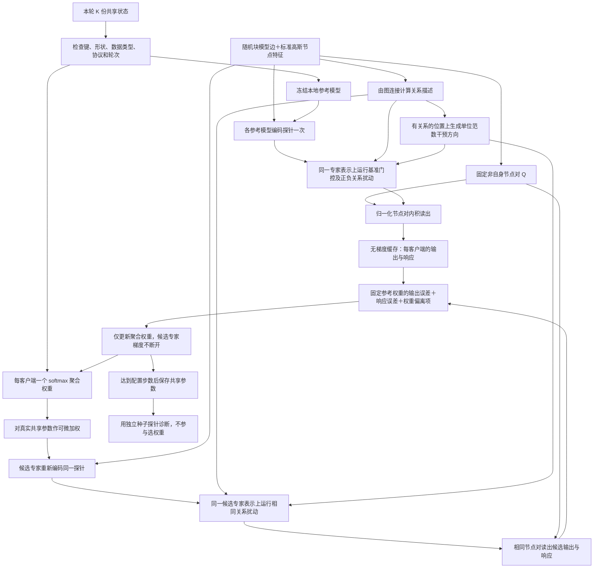

# FedG2C 模块 B：服务器关系响应保持聚合

更新：2026-10-09。已实现独立服务器入口和连接本地训练的单进程联邦轮次入口，聚合产物已接入下游适配。整体职责见 [总览](README_FedG2C.md)，目标域使用方式见 [下游设计](03_下游微调_组合适配.md)。

## 1. 总体设计思路、目的与研究意义

模块 A 让客户端的共享专家和组合器学习如何根据图关系形成节点表示。参数平均后，组合器对同一关系变化的反应可能改变：即使基准输出接近，增强或减弱某个关系条件时的变化方向和幅度也可能不同。模块 B 用一组服务器合成探针同时测量**基准输出**和**关系条件的小幅变化响应**，据此学习本轮各客户端的聚合权重，得到仍由专家与组合器构成的共享模型。

本模块研究的具体问题是：**在不访问客户端真实图、不新增候选模型往返的条件下，能否通过代理输入上的关系响应匹配，减少参数聚合对组合规则的破坏？** 服务器拥有本轮上传的各客户端共享参数；在服务器内部运行这些模型，并完成权重优化。客户端不上传预测器、动量编码分支、私有输入适配器或真实图。

“关系响应保持”是优化目标，不是现阶段已经证明的效果。固定探针上的匹配不等于真实语义分布上的行为保持，更不能直接证明组合泛化。此前合成试跑中的响应误差尚未随校准下降，不能据此声称方法有效。论文需要通过相同输入、相同预算下的普通平均、仅输出匹配和输出＋响应匹配，判断这一约束是否有独立价值。

模块名称暂定为 **服务器关系响应保持聚合**。联合嵌入预测属于模块 A 的训练机制；本模块不使用其 GraphSAGE 预测器，也不训练新的任务分类头。

## 2. 已有工作的依据、具体借鉴和差异

| 来源 | 已有机制／已检查代码 | 本模块如何使用 | 不能混同的地方 |
|---|---|---|---|
| [FED-PUB，ICML 2023](https://proceedings.mlr.press/v202/baek23a.html)；[官方仓库](https://github.com/JinheonBaek/FED-PUB) | `Server.get_proxy_data` 使用随机分块图及均值 0、标准差 1 的高斯节点特征；`Client.get_functional_embedding` 计算代理图表示 | 为低成本随机图＋高斯特征代理输入提供直接先例 | 原方法让客户端计算功能表示并据此个性化聚合；我们在服务器运行上传模型，测量关系干预响应并学习一个共享模型 |
| [FedLAW，ICML 2023](https://proceedings.mlr.press/v202/li23s.html)；[官方仓库](https://github.com/ZexiLee/ICML-2023-FedLAW) | `fedlaw_optimization` 用 softmax 形成客户端权重，以可微参数组合执行前向并优化 | 沿用可学习聚合权重思路，使用 PyTorch 函数式调用实现命名参数组合 | 原代码使用监督代理数据和交叉熵，并可学习整体缩放；本模块不用标签、不学习整体缩放，候选限制在参数凸包内 |
| （合成探针）[GAD，ICML 2026](https://proceedings.mlr.press/v306/huang26bj.html)；[官方仓库](https://github.com/Hannah1102/GAD) | `train_gad_distillation.py` 约 1566–1610 行构造归一化扰动，停止参考侧梯度，比较有限差分响应 | 借鉴“基准行为接近仍不够，还需匹配局部响应”及扰动测量机制 | 原代码在扩散噪声空间用前向差分，含生成模型及其他目标；本模块改为组合器关系门控上的中心差分，仅优化聚合权重 |
| [FedDF，NeurIPS 2020](https://proceedings.neurips.cc/paper_files/paper/2020/hash/18df51b97ccd68128e994804f3eccc87-Abstract.html)；[官方代码](https://github.com/epfml/federated-learning-public-code) | 服务器在无标签输入上读取客户端模型输出并融合 | 作为服务器代理数据校准的相关工作 | 本模块比较任务无关的节点对相似度及关系响应，不平均跨任务分类 logits，不移植其训练系统 |
| 自有 Gefra | `flcore/server.py::Server.execute`、`_aggregate_with_fedavg`，以及客户端 set/pretrain/get 边界 | 保留客户端生命周期和均匀平均对照，新共享结构使用新增服务器类 | 原服务器包含几何对齐；不直接套用其专家槽位匹配，也不导入另一套联邦框架 |

**直接使用的库接口**：[PyG `stochastic_blockmodel_graph`](https://pytorch-geometric.readthedocs.io/en/latest/modules/utils.html#torch_geometric.utils.stochastic_blockmodel_graph)、[PyTorch `torch.func.functional_call`](https://docs.pytorch.org/docs/stable/generated/torch.func.functional_call.html)、`torch.optim.Adam` 和标准张量运算。运行检查使用 PyG 2.7.0、PyTorch 2.12.1。

本模块按这些机制改写薄接口，未直接复制 FED-PUB、FedLAW 或 GAD 的训练实现。节点对读出、关系门控干预、固定参考权重损失及三者结合，是本项目的明确适配，不应引用上述论文来声称组合方案已经得到验证。

### 2.1 官方代码的具体审阅位置

| 仓库及固定提交 | 审阅函数／位置 | 本项目接点 |
|---|---|---|
| FED-PUB `302980ded3bb2b719fd0864e29607031372a3e6d` | [`models/fedpub/server.py::get_proxy_data`](third_party_references/module_b/FED-PUB/models/fedpub/server.py)，原设置每块 100 节点、块内概率 0.1、块间概率 0；[`client.py::get_functional_embedding`](third_party_references/module_b/FED-PUB/models/fedpub/client.py) | `server_probes.py::sample_probe_bank`；改用 PyG 生成器和有界图，不复制其数据分发或功能表示上传 |
| FedLAW `47f7a7226baeb4d684e5d555f793caba874adea3` | [`server_funct.py::fedlaw_optimization`](third_party_references/module_b/ICML-2023-FedLAW/server_funct.py)，约 74–130 行 softmax、参数组合及 `forward_with_param` | `response_server.py::mix_parameters/objective/execute`；使用命名状态和 `functional_call`，避免图编码器改成扁平参数接口 |
| GAD `f49dfd7f33eec1cbe107fa3e4929ca323632471c` | [`train_gad_distillation.py`](third_party_references/module_b/GAD/train_gad_distillation.py) 的扰动归一化、无梯度参考、前向差分响应 | `server_probes.py::ProbeEvaluator.forward` 与 `response_server.py::matching_terms`；改为中心差分，不移植扩散管线 |

固定 URL、提交与每个参考文件的 SHA-256 在 [模块 B 来源清单](third_party_references/module_b/manifest.json)。参考文件原样保留用于审阅，不作为运行依赖。FedLAW 与 GAD 的原许可证保留；FED-PUB 此固定提交未见根目录许可证，参考快照不被本项目重新授权，运行代码只借鉴机制并调用公开库。

## 3. 输入、输出和共享边界

输入为本轮 K 个客户端上传的共享状态，参数仅包含 `experts.*` 与 `composer.*`。要求共享架构、关系定义、归一化配置和专家槽位兼容，并从同一轮下发状态训练而来。各客户端原始节点／边特征维度可以不同，因为私有适配器留在本地。

输出为一个加权聚合后的共享状态，仍只有专家和组合器；下一轮通过模块 A 的 `set_pretrain_model` 下发。模块 C 已通过 `target_model.load_shared` 加载这一聚合产物，不能把模块 A 的某个本地候选误称为全局模型。

| 对象 | 来源 | 使用位置 | 是否发给客户端 |
|---|---|---|---|
| 本轮客户端共享状态 | 模块 A 上传 | 冻结参考模型与参数候选构造 | 聚合前不新增下发 |
| 合成图、节点噪声、关系方向、测量节点对 | 服务器生成 | 本轮校准与独立诊断 | 否 |
| 参考读数缓存 | 冻结上传模型前向 | 服务器固定匹配目标 | 否 |
| 每客户端一个可学习权重 | 服务器初始化并优化 | 加权共享参数 | 不必发回 |
| 聚合后的共享模型 | 最后一步权重对应的参数候选 | 下一轮本地训练／后续模块 C | 按正常轮次下发 |
| 私有适配器、GraphSAGE 预测器、动量副本 | 客户端 | 模块 A | 不上传服务器 |

原始上传模型不被优化器修改。候选参数由权重和固定上传参数计算，候选没有独立可自由训练的模型参数。

**运行消息与磁盘文件分开处理。** 运行中的下发沿用 Gefra 的 `[(参数名, 张量), ...]`，上传为 `客户端 ID → {"num_samples": 1, "weight": [(参数名, 张量), ...]}`。`num_samples=1` 沿用原代码占位约定，不是实际图或节点样本数，不改变当前均匀基准和参考权重。新消息只传 `experts.*` 与 `composer.*`，不附带几何统计、私有适配器或训练数据；取参数的独立 CPU 快照，避免引用客户端随后可变的参数。运行消息不需要磁盘 `stage/schema_version` 字段。默认 `mysage` 的共享状态全部是参数；其他编码器若有必要的缓冲区，也以命名张量随完整共享状态传输，服务器继续执行缓冲区必须相同的规则，不将其当作可学习参数平均。

独立聚合入口从磁盘读取 `{"metadata": ..., "client_id": ..., "state_dict": ...}` 时，`load_uploads` 要求 `stage=local_pretraining_only`、整数 `schema_version=2`。若文件带有 `shared_schema_version`，必须为 1；带有 `local_design`，必须为 `edge_prediction`。已有合法版本 2 文件允许缺少后两个字段，以兼容此前联邦入口和独立入口的保存差异；未知／缺失阶段或版本会明确报错，不猜测转换为合法文件。

随后检查客户端 ID、共享架构、协议、关系定义、轮次和共同起点记录；`prepare_states` 检查完整参数键、形状、类型、有限性和缓冲区规则。原 `moe_encoder.pt` 是旧架构的独立状态字典，不是新上传文件，不能因消息结构相同就直接加载。

## 4. 数据流：联邦轮次与服务器内部

### 4.1 A 与 B 的轮次连接



当前新增入口是**单进程联邦仿真**：轮次、上传边界和下发边界明确，客户端私有数据仍由客户端训练接口读取，但并非生产级分布式网络部署。当前每轮全客户端参与；客户端抽样、掉线恢复和精确断点续训尚未实现。

### 4.2 服务器内部详细数据流



## 5. 探针具体如何生成与测量

### 5.1 图、特征和关系

一份探针包含 `x [N,d]`、`edge_index [2,E]`、`relations [N,N,3]`、`pairs [Q,2]` 和 `directions [D,N,N]`。这里 d 等于共享专家输入维度。x 的每个元素独立来自均值 0、标准差 1 的高斯分布；社区编号仅用于生成连接，不作为语义标签或额外节点特征。

图由 PyG 随机块模型函数生成，社区大小与块间概率矩阵由配置指定，无自环；无向模式的边成对存储。没有学习型生成器，没有读取客户端图的统计量。生成时隔离 PyG 的随机数状态，避免服务器探针采样改变模块 A 的随机训练状态。两个客户端特征维度不同也使用同一份 `[N,d]` 探针，因为输入位于私有适配器之后、共享专家之前。

关系描述沿用模块 A 的“自身、直接边、两跳可达”，由合成图推导。测量节点对从所有不同节点的无序对中随机无放回选取，排除自身对，防止自身余弦相似度恒为 1 成为主要读数。节点对可以有边也可以无边，它们是测量位置，不是链接预测标签，无需为测量删除该边。

**边属性处理：** 本版探针不生成边属性，传入共享专家的 `edge_attr=None`。这与目前专家允许无边属性的接口一致。即使客户端使用了真实键特征，服务器也不会合成“假化学键属性”；此时探针只测试无边属性输入下的共享行为，不覆盖真实边属性通道，这是正式分子实验需要报告的局限。

### 5.2 “关系响应”具体是什么

对一个模型，先只编码一次专家表示：

\[
H=E_\theta(X,A)\in\mathbb R^{N\times M\times d}.
\]

组合器原有关系偏置为 `b_h(r_uv)`。本模块通过已有 `relation_gate` 接口将其变为 `g_uv b_h(r_uv)`，基准门控全为 1。在至少有一种关系描述非零的位置生成高斯方向；无向模式使方向对称，随后以整个方向矩阵的 Frobenius 范数归一化为 1。支持集包含自身关系、直接边和两跳关系，因此即使某个合成图没有边，方向也有定义；响应强弱交由诊断记录，不因读数偏小偷偷重采样。

分别使用 `g=1`、`g=1+εδ`、`g=1−εδ`，**保持图连接、节点特征、关系描述和本次专家表示完全相同**。这里增强／减弱的是组合器内关系条件的贡献，不是增删真实化学键，也不扰动专家消息传递。

对于组合表示 Z，在固定节点对上读取归一化内积：

\[
s_q(g)=\left\langle
\frac{z_u(g)}{\max(\|z_u(g)\|,10^{-8})},
\frac{z_v(g)}{\max(\|z_v(g)\|,10^{-8})}
\right\rangle,\quad (u,v)\in Q.
\]

基准读数为 `s(1) [Q]`，第 j 个方向的中心有限差分响应为：

\[
R_j=\frac{s(1+\epsilon\delta_j)-s(1-\epsilon\delta_j)}{2\epsilon}\in\mathbb R^Q.
\]

该读出不需要共同下游类别空间，对共同正交坐标变换不敏感，但不保留全部表示信息。不同客户端对同一噪声产生不同表示，仅表示模型间差异；只有同一模型在正负关系门控下的读数变化才是这里定义的关系响应。

### 5.3 固定什么、何时重算

- 本轮上传参数、参考读数、校准探针、测量节点对、方向和固定参考权重均不随服务器优化改变。
- **每个候选、每份探针**的专家只编码一次，供基准及所有正负关系扰动共用；候选专家输出仍保留到聚合权重的梯度。
- 聚合权重更新后，候选专家表示必须重新计算。`E(加权参数)` 一般不等于 `加权的 E(本地参数)`。
- 下一轮上传模型改变，参考缓存重新生成。默认探针种子也随轮次改变，但同一轮内部固定。
- 独立诊断探针使用不同种子，仅记录聚合前后误差，不用于选最佳步、提前停止或调整当轮权重。本版按预设步数取最后一步。

## 6. 聚合目标与参数更新

对 K 个客户端，每个客户端只学习一个标量权重，全模型各层共用，不另设逐专家／逐层权重：

\[
w=\operatorname{softmax}(a),\qquad
\theta(w)=\sum_{i=1}^{K}w_i\theta_i.
\]

与 Gefra 的当前固定平均对照一致，命令行默认 `p_i=1/K`，初始化 `a_i=log p_i`。固定参考权重默认 `ρ_i=1/K`。服务器类接口允许显式传入固定分布，但 `p` 和 `ρ` 不随待学习权重 w 改变，避免通过降低某个客户端的参考权重轻易回避其误差。

\[
\mathcal L(w)=\lambda_o\sum_i\rho_i\operatorname{MSE}(s_w,s_i)
+\lambda_r\sum_i\rho_i\operatorname{MSE}(R_w,R_i)
+\lambda_p\|w-p\|_2^2.
\]

均方误差在校准图、测量节点对以及响应方向上分别取平均，再按客户端固定权重求和。参考响应不被直接按可学习 w 加权。不同客户端响应冲突时，该目标只是在固定参考之间折中，不保证每个客户端误差都下降。

实现使用 `torch.func.functional_call` 对真正的加权参数进行前向，避免 `load_state_dict` 断开聚合权重到模型输出的梯度。仅对聚合 logits 使用 Adam，参考模型及模板参数不参与优化。已有共享结构采用层归一化，服务器处于推理模式关闭随机丢弃；若出现非参数缓冲区，只允许各上传模型中的对应值完全相同，不把整数计数器或运行统计静默当作参数平均。

当前输出误差与响应误差没有自动归一化或自适应重加权，三个系数均显式配置。合成检查中响应误差比输出误差小数个数量级，因此配置中都取 1 并不代表两者贡献相当；需要在允许的校准条件下研究系数、方向数量和 ε，不能使用测试组合调参。

## 7. 伪代码

```text
接收本轮各客户端共享状态
检查共享架构、关系定义、协议、轮次和共同初始化记录
固定上传参数；仅建立每客户端一个可学习聚合权重

若选择普通平均：
    按固定权重平均命名参数
    返回共享状态；不生成探针，不优化服务器参数

生成固定校准探针和独立诊断探针
对每个客户端、每份探针，在无梯度模式：
    编码专家表示 H
    读取基准门控输出 s
    固定 H，在相同方向上作正负关系门控扰动
    缓存中心有限差分响应 R

用基线权重初始化聚合 logits
重复配置的服务器优化步数：
    w = softmax(logits)
    候选参数 = 按 w 可微加权上传参数
    对每份校准探针：
        用候选参数重新编码专家表示 H_w，保留梯度
        用同一个 H_w 读取基准和正负扰动输出
        得到候选输出 s_w 与响应 R_w
    损失 = 固定参考权重下的输出误差 + 响应误差 + 偏离基线项
    只更新聚合 logits

用最后一步权重生成共享状态
在校准探针和独立诊断探针记录聚合前后指标
保存共享状态、最终权重、配置、探针张量、轮次和来源摘要
按原联邦节奏在下一轮下发共享状态
```

## 8. 以模块为单位的代码接入说明

| 文件／函数 | 改动与目的 | 接入哪里／来源 |
|---|---|---|
| [fedg2c/server_config.py](fedg2c/server_config.py) `ResponseAggregationConfig` | 显式描述图、方向、损失与优化配置 | 模块 B 新增；没有伪称默认值为论文最优配置 |
| [fedg2c/server_probes.py](fedg2c/server_probes.py) `sample_probe_bank` | 生成随机块模型图、标准高斯特征、节点对与方向 | 直接调用 PyG；FED-PUB 代理输入机制的有界图适配 |
| 同文件 `pair_readout` | 无可训练参数的节点对余弦读出 | 接在组合器输出后；任务无关读出是本项目选择 |
| 同文件 `ProbeEvaluator.forward` | 每份探针一次专家编码、基准＋正负关系前向 | 调用模块 A 的 `SharedBackbone.encode_experts` 与 `RelationComposer.forward(relation_gate=...)`；借鉴 GAD 响应测量，改为中心差分 |
| [fedg2c/response_server.py](fedg2c/response_server.py) `mix_parameters` | 命名参数的可微凸组合；独立处理缓冲区 | FedLAW 参数权重学习思路；使用 PyTorch 而非其扁平参数模型 |
| 同文件 `ResponsePreservingServer.reference_cache/evaluate_state` | 冻结参考缓存与候选真实前向 | 无梯度参考、候选保留梯度，缓存限定在本轮调用 |
| 同文件 `matching_terms/objective/execute` | 固定参考损失、权重优化、平均对照和诊断 | 新增服务器执行边界，对应 Gefra `Server.execute` 的聚合位置，不修改其几何逻辑 |
| [fedg2c/messages.py](fedg2c/messages.py) `named_weights/state_from_named_weights/client_message/states_from_client_messages` | Gefra 形状的下发列表和上传字典；拒绝重复键、私有／几何字段和无效张量 | 对照原 `flcore/client.py::get_pretrain_model/set_pretrain_model` 与 `flcore/server.py::execute/get_global_message`；只迁移消息结构，不迁移几何算法 |
| [fedg2c/edge_client.py](fedg2c/edge_client.py) `get_local_message/set_pretrain_model` | 将原状态接口包装为运行消息；下发兼容列表并重置动量副本 | `get_pretrain_model` 保留为原始状态字典接口，供磁盘保存和旧调用使用 |
| [fedg2c/server_io.py](fedg2c/server_io.py) `load_uploads/save_aggregation/state_digest` | 检查共享架构、协议与轮次；保存权重和可移植来源 | 检查本地阶段与版本 2，再做架构、轮次和来源检查；可选字段兼容范围见第 3 节 |
| [fedg2c/edge_entry.py](fedg2c/edge_entry.py) `run` 的上传元数据接点 | 在原本地输出元数据中追加共同初始化指纹和轮次 | 唯一新增的 A 输出到 B 校验接点；原训练逻辑未改变 |
| [aggregate_fedg2c.py](aggregate_fedg2c.py) `main` | 聚合已保存的模块 A 上传文件 | 独立测试 B，不重跑客户端训练 |
| [pretrain_federated_fedg2c.py](pretrain_federated_fedg2c.py) `main` | 完整 A→B→下一轮 A 循环 | 使用 Gefra 形状的运行消息，复用本地客户端与共享骨架；原始状态列表调用保留在注释及服务器兼容接口中 |

原 `flcore/server.py`、`pretrain_gefra.py` 等运行实现保留。没有让原几何服务器静默读取新共享模型；新增入口复用自有模块 A 的生命周期，并在该明确边界接入模块 B。旧程序依旧可单独运行。

## 9. 配置起点、入口和对照开关

[服务器配置](config/fedg2c_server_response.json) 是**可运行的合成检查起点**：2 个社区，每个 8 节点；块内概率 0.5、块间概率 0.1；4 个校准图、2 个诊断图；每图 16 个节点对、2 个单位范数方向；ε=0.01；10 次 Adam 更新，学习率 0.05；输出／响应系数为 1，权重偏离系数为 0.001。上述数值是显式工程设置，未经过真实任务选择。只有高斯标准差 1、随机块模型、关系响应和纯服务器校准属于已讨论确定的设计。

### 9.1 单独运行模块 B

下面先生成本地上传文件，再执行独立聚合；分享目录不附带运行产物。正式实验应换成本轮真实客户端输出。输出目录必须不存在。

```bash
python pretrain_fedg2c.py --use-new-design --smoke --max-steps 3 \
  --output runs/local_upload_001

python aggregate_fedg2c.py \
  --client-checkpoints \
    runs/local_upload_001/client_0/shared_backbone.pt \
    runs/local_upload_001/client_1/shared_backbone.pt \
  --server-config config/fedg2c_server_response.json \
  --aggregation response \
  --output runs/server_response_001
```

旧的 10 月 9 日模块 A 产物没有共同初始化指纹，加载器只能检查已有 seed、共享架构、关系定义与协议，并在元数据明确记录共同初始化和槽位对齐仍为假设。新产生的模块 A checkpoint 和联邦轮次产物包含指纹；指纹不一致或缺失与存在混用会报错。共同起点也不证明长期训练后绝无专家置换，本版没有引入槽位匹配算法。

### 9.2 连续运行模块 A＋B

```bash
# 小型合成图：两客户端、两轮，每轮各三步本地训练
python pretrain_federated_fedg2c.py --smoke \
  --server-config config/fedg2c_server_response.json \
  --aggregation response --rounds 2 --local-steps 3 \
  --output runs/federated_response_001

# 真实源数据：清单必须先按实验协议准备好，下面路径是示例
python pretrain_federated_fedg2c.py \
  --source-manifest data/source_manifest.json \
  --config config/fedg2c_edge_prediction.json \
  --server-config config/fedg2c_server_response.json \
  --aggregation response --rounds 10 --local-epochs 1 \
  --output runs/federated_source_001
```

模块 A 配置默认 GraphSAGE 预测器。联邦入口在多轮间保留客户端私有适配器和预测器；每次下发新共享状态后重置动量副本，每轮本地调用重新建立优化器。真实清单的含义与格式见 [模块 A](01_本地预训练_关系条件专家组合学习.md)，它不自动下载、划分或审计真实数据。

| `--aggregation` | 行为 | 开销与边界 |
|---|---|---|
| `fedavg` | 固定均匀平均 | 关闭模块 B 的校准，不生成探针；与 Gefra 原均匀平均规则一致 |
| `output_only` | 仅输出匹配＋权重偏离项 | 同样学习权重；关系响应仅用于诊断，不进入优化目标 |
| `response` | 输出匹配＋关系响应匹配＋权重偏离项 | 当前完整模块 B；要求组合器启用关系分支 |

无关系条件或线性门控组合器可使用 `fedavg`／`output_only`，但不能使用 `response`；没有关系分支时响应诊断记录为 `null`，不伪装成“成功保持了零响应”。普通平均模式不自行生成诊断探针；输出／响应模式中的 `before` 指标就是相同探针上的固定平均基准。`output_only` 优化历史中的 `response_mse=0` 是该项未计算时的占位值，不表示响应误差为零；实际响应误差应读取 `calibration_before/after` 或 `diagnostic_before/after`，没有关系分支时这些诊断字段为 `null`。

## 10. 保存内容、通信和复现边界

独立服务器或每轮 `server/` 保存：

- `shared_backbone.pt`：聚合后共享状态、模型配置、服务器配置、协议、轮次、来源摘要及状态哈希。
- `aggregation_report.json`：最终权重、固定参考权重、逐步优化指标、校准与独立诊断的聚合前后误差及参考响应幅度。
- `server_probes.pt`：本次实际使用的图、噪声、节点对、关系描述和方向，便于逐项重放；普通平均模式无此文件。
- `run_metadata.json`：可读元数据；不写入机器绝对路径。

联邦入口额外保存每轮各客户端共享上传、客户端损失、最后的私有模型权重和 `communication.json`。私有文件只是仿真中的客户端本地快照，从未传入服务器聚合函数；这些文件不含优化器／随机数状态，不能据此宣称精确断点续训。

通信仍为每轮一次共享模型下发、一次本地共享模型上传。服务器十步校准不等于十轮通信。通信记录只统计共享张量有效载荷字节数，不含序列化、网络协议、失败重传或磁盘开销。校准增加服务器计算与缓存成本；本实现一次性保留本轮所有上传参数，不能宣称具备大规模部署的内存效率。

服务器能读取每个客户端的共享参数是前提；若只允许看到模型总和的安全聚合，需要另外设计。这里不额外承诺隐私保护强于普通参数上传。

## 11. 研究边界与下一步实验

**这种计算能否保留关系响应、改善组合泛化仍需实验验证。** 此前合成试跑的起点配置中，校准输出误差下降，响应误差及独立探针误差未同步改善，不能据此报告方法有效。

后续正式实验至少需固定以下条件：相同源模型和探针预算下比较三种聚合方式；检查响应是否接近零、差分步长是否稳定、响应权重是否有效；报告服务器时间／显存；在允许的数据上诊断真实关系响应并验证下游组合留出性能。诊断数据不能暗中参与每轮权重选择。

**组合留出同样约束服务器探针。** 被用于权重优化的随机图属于预训练输入，可能包含非分子结构协议中留出的组合。本版不自动识别或过滤这些组合；正式实验应提供协议过滤或明确采用代理辅助设置。标准高斯特征不是合法原子类别，也不代表真实分子语义因素组合，不能用“随机生成”替代协议论证。

## 12. Gefra 传输格式对应关系

已与原 Gefra 对照：`pretrain_gefra.py` 的轮次循环传递内存中的 Python 字典／列表，`flcore/client.py::get_pretrain_model` 用 `weight` 保存命名参数；另附带的专家分布和关系低秩因子服务于原几何聚合，不属于新方法需要共享的内容。原 `model/pretraining.py::save_encoder` 则单独保存编码器状态字典，它与运行消息是两个不同接口。

新联邦入口按相同消息形状传输，并保留新基座必需的参数命名、完整组合器与检查点元数据。转换函数不参与梯度计算，不改变服务器损失或通信轮次。服务器在解包后仍调用同一个参数聚合实现。
