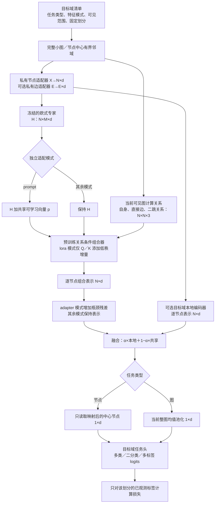

# FedG2C 第三阶段：下游组合适配

更新：2026-10-09。已实现独立下游入口、三种适配方式、图／节点读出、可选本地编码器及训练评估。相关设计见 [总览](README_FedG2C.md)、[本地预训练](01_本地预训练_关系条件专家组合学习.md)、[服务器聚合](02_服务器聚合_关系响应保持.md)。

## 1. 总体设计思路、目的与研究意义

前两阶段得到的是可共享的专家与关系条件组合器。第三阶段研究如何在目标域使用这套能力：冻结聚合基座原参数，新建目标域输入适配器和任务头，分别采用低秩适应、组合输出残差适配器、组合输入可学习提示进行小规模调整。相同接口覆盖非分子节点分类，以及分子和非分子图分类；边属性存在时按声明使用，不存在时不生成伪边属性。

这部分首先是**迁移验证与适配接口**。我们要检验前两阶段的收益能否在不同任务、不同适配方式下稳定保留，而不是靠大量目标域训练掩盖基座差异。三个对照沿用成熟技术；插入位置属于本项目的适配选择，暂不单独声称为新的算法贡献。

默认只使用共享分支。可另外建立目标域本地编码器，用融合系数观察模型对共享知识与目标域学习的依赖；该网络从头初始化，不加载任何源客户端私有编码器。融合系数扫描只能反映控制条件下的表现变化，不能直接解释为因果贡献比例。

## 2. 现有依据、具体迁移内容和差异

| 技术与论文 | 检查过的官方代码 | 当前实现与必要改动 |
|---|---|---|
| 低秩适应（Low-Rank Adaptation，LoRA），[ICLR 2022](https://openreview.net/pdf?id=nZeVKeeFYf9) | [microsoft/LoRA](https://github.com/microsoft/LoRA)，`loralib/layers.py::Linear.__init__/forward/train` | **直接使用官方类**；将组合器 `query`、`key` 两个线性层换为保持原权重的低秩层。基础权重与偏置冻结，关闭权重合并 |
| [AdapterGNN，AAAI 2024](https://ojs.aaai.org/index.php/AAAI/article/view/29264) | [Lucius-lsr/AdapterGNN](https://github.com/Lucius-lsr/AdapterGNN)，`chem/adapterGNN.py::GNN.__init__/forward` 中 `prompts` 的降维、ReLU、升维及零初始化 | **借鉴瓶颈残差机制，独立实现**。在组合输出后只放一个适配器，不迁移原论文的逐层双分支、归一化和门控；不称为完整复现 |
| [Universal Prompt Tuning for Graph Neural Networks，NeurIPS 2023](https://proceedings.neurips.cc/paper_files/paper/2023/hash/a4a1ee071ce0fe63b83bce507c9dc4d7-Abstract-Conference.html) | [LuckyTiger123/GPF](https://github.com/LuckyTiger123/GPF)，`chem/graph_prompt.py::SimplePrompt.add/reset_parameters` | **改写其加性提示机制**。把单个共享向量加到专家输出、组合器输入处；原实现用 Glorot 初始化，本实现用零初始化以保持初始基座功能。不迁移多提示注意力变体 |

固定提交分别为：LoRA `c4593f060e6a368d7bb5af5273b8e42810cdef90`；AdapterGNN `9be3663610e0d06c85ec0bce27689d6574507001`；GPF `116ac462e593a67b99471f165e219e45a97cfc11`。完整来源、用法及文件哈希见 [来源清单](third_party_references/module_c/manifest.json)。

LoRA 的官方包保存在 [fedg2c/vendor/loralib](fedg2c/vendor/loralib)，保留 MIT 许可证，不需要安装完整论文训练框架。另两者的审阅快照在 [third_party_references/module_c](third_party_references/module_c)。AdapterGNN 此提交未见根目录许可证，其快照不被本项目重新授权，运行实现不导入该文件。

**首版提示的准确名称是“组合输入提示”。** 它不新增图节点或独立查询 token，而是改变已有专家 token 的输入，因此会同时影响冻结查询、键和值映射的输入。这比将它描述为“只训练查询提示”更符合实际代码；没有凭空定义提示节点与真实图之间的边。

## 3. 输入、输出与参数边界

### 3.1 从预训练加载什么

`load_shared` 只接受服务器输出的 `stage=server_aggregation`、元数据版本 3、共享模式版本 1 检查点，并验证关系模式和状态哈希，严格加载架构及参数。单客户端本地检查点、旧 Gefra 几何检查点不能静默进入新流程。上游运行消息已沿用 Gefra 的 `weight` 命名参数列表，但本模块继续读取服务器保存的完整聚合检查点，磁盘格式和冻结边界不变。

| 内容 | 下游处理 |
|---|---|
| 全部欧式专家 `experts.*` | 加载并冻结 |
| 完整组合器 `composer.*`，包含关系映射 | 加载，冻结所有原参数；低秩模式只添加新的可训练矩阵 |
| 源域私有节点／边适配器 | 不加载，按目标域特征模式新建 |
| GraphSAGE 预训练预测器、预测位置投影、动量编码分支 | 不加载 |
| 服务器探针、参考模型与关系响应缓存 | 不加载 |
| 目标域任务头、可选目标域本地编码器 | 新建并训练 |

“冻结”指原参数不更新，**不等于把整个共享前向放进 `no_grad`**。梯度必须穿过冻结基座，才能更新输入适配器、提示或低秩参数。共享模块保持评估模式，固定 Dropout 等行为；官方低秩层设 `merge_weights=False`，训练／评估切换不写回基座权重。

### 3.2 训练参数与开关

| `adaptation` | 特有训练参数 | 初始函数是否等于无额外适配 | 改变组合过程的位置 |
|---|---|---|---|
| `none` | 无 | 是 | 不加额外模块 |
| `lora` | 查询／键映射的低秩矩阵 | 是，升维矩阵初始为零 | 改变内容查询与键；关系映射原参数保持冻结 |
| `adapter` | 单个降维／升维残差网络 | 是，升维权重和偏置初始为零 | 组合输出之后；它本身不直接改写组合权重 |
| `prompt` | 一个维度为 d 的加性向量 | 是，提示初始为零 | 所有节点、所有专家 token 进入组合器之前 |

四种模式都训练目标域输入适配器和任务头。因此 `none` 是**无额外适配基线**，不是严格的“只训练线性头”探针。四种模式按相同随机种子先初始化公共部分，再初始化各自额外参数，避免因构造顺序不同改变公共任务头。

不同方式参数量不相等，程序按组报告。在合成检查的连续输入 F=5、d=64、单输出二分类图任务、不使用边属性、本地分支关闭时，输入适配器和任务头共 449 个参数；额外低秩参数 1,024 个、残差适配器 1,096 个、提示 64 个。连续节点输入与线性任务头的公共训练参数量为 `(F+1)×d+(d+1)×T`，T 是输出维度；类别嵌入、边适配器和本地分支需另计，不能将 449 当作所有数据集的固定值。正式公平比较还应检查等预算或相近预算设置。

## 4. 详细数据流

### 4.1 单个目标图或节点邻域的前向



N 是当前视图节点数，M 是专家数，d 是共享隐藏维度。模型逐视图计算，再拼接任务输出组成训练批次；不同图不会混入同一张关系矩阵。图任务不会先池化再进入组合器。

连续节点特征先线性投影；离散特征使用声明的逐列类别嵌入，相加得到 d 维输入。边属性也按声明处理，当前有边属性时要求 `mysage`；无边属性时传 `None`，只使用拓扑。下游不重复预训练的遮边和特征遮蔽，不加载预测器位置编码。标签、划分和组合因素不作为模型特征。

### 4.2 三种方式的计算

低秩适应对组合器中的两个原矩阵分别添加更新：

\[
W_Q'=W_Q+\frac{s}{r}B_QA_Q,\qquad
W_K'=W_K+\frac{s}{r}B_KA_K.
\]

r 是秩，s 对应配置 `lora_alpha`，与本地融合系数无关。仅新矩阵可训练，原查询／键偏置、值映射、输出映射、关系映射、归一化和专家参数全部冻结。保留原权重后再插入官方低秩层；不重新初始化预训练组合器。该模式不支持没有查询／键线性层的 `linear_gate` 对照，程序会明确报错。

残差适配器：

\[
\widetilde Z=Z+W_{up}\operatorname{ReLU}(W_{down}Z+b_{down})+b_{up}.
\]

它调整组合结果的表达空间，适合检验“仅调整读出前的表示是否足够”。其优势是实现简单、参数较少、初始不扰动基座；能否优于其他适配方式仍需实验。

组合输入提示：

\[
\widetilde H_{v,m}=H_{v,m}+p,\qquad Z=C(\widetilde H,R).
\]

p 在全部节点和专家之间共享，保持当前完整视图内的节点置换等变性；不增加提示边、不改变关系张量形状。将公开加性提示机制从编码输入迁移到专家组合输入，是本实现的设计选择，并非 GPF 原文验证过的相同设置。

### 4.3 可选本地分支及节点视图

\[
Z_{final}=\alpha Z_{local}+(1-\alpha)\widetilde Z_{shared}.
\]

默认 α=0，不创建本地编码器。0<α<1 时，两个分支使用同一个目标域私有输入适配器，逐节点融合后再读出；α=1 是纯本地对照，跳过共享前向，也不把闲置适配参数计入训练参数。可训练系数采用 `sigmoid(alpha_logit)`，必须从严格位于 (0,1) 的值开始。

节点任务按中心节点提取 k 跳有界邻域，复用现有 `NeighborhoodEdgeSampler.neighborhood` 与 PyG 子图重编号；只用根节点标签训练，每次前向只读其表示。截断时按稳定节点索引顺序选取，保留根节点与原始 ID。邻域选择用无向邻接，消息传递和关系计算仍保留原图边方向。孤立根节点允许形成单节点视图。

这是有界视图上的预测，不保证等于整张节点图的全局组合结果。达到节点上限时，按 ID 截断可能改变重编号后的采样结果；这里讨论的置换等变性限于**固定完整视图内部**的计算。首版还会在加载时建立所有待预测节点的视图，适合先验证中小规模协议；大型节点图的惰性采样、缓存与高效回写仍需专门实现。整图分类不进行隐式截断，图超过 `max_nodes` 时明确报错，避免将整图标签错配给随机片段。

## 5. 训练、验证与伪代码

```text
读取目标清单，检查任务、特征模式、可见范围和样本划分
拒绝重复图样本、重复根节点，以及跨划分的相同预测样本
加载并校验服务器聚合基座；冻结全部原参数
建立目标域输入适配器和任务头
按需建立目标域本地编码器
从低秩适应／残差适配器／提示中选择一种，或不加额外适配

for epoch:
    仅打乱训练样本
    for batch in 训练划分:
        对每个样本独立计算专家、关系、组合表示与任务 logits
        多类：交叉熵；二分类／多标签：只在非缺失位置计算二元交叉熵
        反向传播；只更新 requires_grad=True 的参数
    在验证划分上无梯度评估
    只按最低验证损失保存最佳状态，平局保留较早轮次

恢复验证选中的状态
核对全部预训练基座参数与服务器输入的哈希一致
只在此时评估测试划分
保存完整目标模型、参数分组、来源元数据和指标
```

评估二分类／多标签的受试者工作特征曲线下面积（ROC-AUC）和平均精确率（Average Precision，AP），多标签结果在具有正负样本的有效任务上取宏平均；无有效任务时记为 `null` 并报告数量，不填成零。实现按相同分数分组计算曲线，避免并列分数排序影响指标。当前 AP 也只统计同时有正负样本的任务，此约定会写入结果的有效任务数。

缺失标签只支持二分类／多标签的 `NaN`；多类样本必须提供合法类别索引。不同数据集的 -1/0/1 编码需在准备清单时明确转为 0/1/NaN，不能把“缺失”默认为负类。清单加载时会读取并校验所有划分的标签；训练参数更新与轮次选择不使用测试标签，测试指标只在选好模型后计算一次。因此这里保证的是测试标签不参与拟合和选择，而不是测试数据在训练前完全不加载。后续实验可通过修改测试标签并比较选中模型参数，检查这一隔离边界。

## 6. 逐文件、逐函数的接入说明

| 文件与函数 | 接入位置及作用 | 实现依据 |
|---|---|---|
| [finetune_fedg2c.py](finetune_fedg2c.py) `main` | 新设计开关；否则转到原 `finetune_gefra.py` | 沿用项目入口分派方式，旧微调文件不改 |
| [fedg2c/target_model.py](fedg2c/target_model.py) `load_shared` | 从模块二聚合产物读取共享模式、关系模式、架构与哈希 | 复用 `server_io.state_digest` 和 `SharedBackbone` |
| 同文件 `install_lora` | 替换**内存模型**的 `shared.composer.query/key`；复制原权重偏置后添加低秩参数 | 官方 `loralib.Linear`，不改 `composer.py` |
| 同文件 `ResidualAdapter.__init__/forward` | 插在 `shared.composer(...)` 输出后 | AdapterGNN 瓶颈与零初始化机制的简化适配 |
| 同文件 `TargetModel.__init__/forward` 的 `prompt` | 插在 `encode_experts` 与 `composer` 之间 | GPF `SimplePrompt.add` 的加性机制，改变插入位置及初始化 |
| 同文件 `TargetModel.forward` 的本地分支与读出 | 复用 Gefra 图编码器封装，逐节点融合；按图均值池化或根节点读出 | 自有骨架与显式工程对照，不声称来自新论文算法 |
| 同文件 `train/frozen_base_unchanged/parameter_report` | 固定共享评估行为；检查基座不变；统计各组训练参数 | 支持冻结与公平比较的工程检查 |
| [fedg2c/target_data.py](fedg2c/target_data.py) `load_target_manifest` | 标签、可见范围、划分、节点采样与根节点映射 | 复用本地模块邻域与 PyG 子图；不推断组合因素 |
| [fedg2c/target_train.py](fedg2c/target_train.py) `classification_loss/run_target` | 训练更新、缺失标签掩码、验证选择、最终测试 | 标准 PyTorch 损失与 AdamW；无新增训练框架 |
| 同文件 `binary_ranking/metrics/evaluate` | 分类与排名指标，处理并列分数和无效任务 | 标准曲线定义的张量实现 |
| 同文件 `load_target_model` | 独立重建并严格加载已训练目标模型 | 完整保存架构与权重，无须从旧 Gefra 加载器恢复 |
| [fedg2c/target_smoke.py](fedg2c/target_smoke.py) `write_smoke_manifest` | 合成图二分类／节点多类任务的接口数据 | 只用于计算路径检查，自动标注 `smoke_only` |

## 7. 数据清单、配置与启动方式

目标清单使用独立 schema，不把源客户端清单直接当作监督任务清单。所有路径相对清单文件所在目录，数据文件使用 `torch.save` 保存张量字典；清单不接受绝对路径或 `..`。

图任务示例（文件需按真实协议准备）：

```json
{
  "schema_version": 1,
  "protocol_id": "target-composition-split-v1",
  "task": {"level": "graph", "objective": "binary", "num_outputs": 1},
  "visibility": "split_graphs",
  "feature_schema": {"input_dim": 9, "edge_dim": 0},
  "splits": {
    "train": [{"path": "train_000.pt"}],
    "valid": [{"path": "valid_000.pt"}],
    "test": [{"path": "test_000.pt"}]
  }
}
```

每个图文件含 `graph_id`、`x:[N,F]`、`edge_index:[2,E]`、`y`，可选 `edge_attr:[E,F_edge]` 和 `original_node_id:[N]`。图 ID 必须唯一指向一个文件；同一图不能跨整图任务划分。分子类别特征需显式增加 `node_cardinalities`，存在类别边特征时设置 `edge_dim` 和 `edge_cardinalities`。上例的 9 列连续输入只是模式示例，不表示原子类别编号可直接当作连续数值。

节点任务将 `level` 设为 `node`；多类任务用 `objective=multiclass` 和类别数。文件内 `y` 的首维必须为 N，各划分条目提供根节点索引：

```json
"train": [{"path": "graph.pt", "indices": [0, 1, 2]}],
"valid": [{"path": "graph.pt", "indices": [3, 4]}],
"test":  [{"path": "graph.pt", "indices": [5, 6]}]
```

以上同图设置必须声明 `visibility=transductive`，表示完整图的特征与结构允许进入邻域，但只有训练根节点标签用于更新。归纳式设置使用 `split_graphs` 和事先分离的图文件，跨划分复用同一图 ID 会被拒绝。程序只能检查声明的 ID 与索引，不会自动识别改名的重复图，也不会证明数据满足组合留出协议。

[默认配置](config/fedg2c_target.json) 是可运行起点：低秩秩 4、缩放 4、瓶颈宽度 8、20 个训练轮次、批量 8、学习率 0.001、节点上限 128、节点邻域 2 跳、α=0。它们不是论文报告的跨任务最优值，应仅用允许的验证划分选择。

```bash
# 已经完成模块二后，指定其聚合检查点
python finetune_fedg2c.py --use-new-design \
  --checkpoint runs/federated_001/round_001/server/shared_backbone.pt \
  --target-manifest data/target/manifest.json \
  --adaptation lora --output runs/target_lora_001

# 合成节点任务接口检查；图任务改为 --smoke-level graph
python finetune_fedg2c.py --use-new-design \
  --checkpoint runs/federated_001/round_001/server/shared_backbone.pt \
  --smoke --smoke-level node --adaptation prompt --epochs 2 \
  --output runs/node_prompt_smoke_001
```

同一清单、基座、种子下，分别选择 `--adaptation none/lora/adapter/prompt` 并使用不同输出目录。固定本地比例使用 `--local-alpha 0.5`，可学习比例再加 `--learnable-alpha`；纯本地对照建议用 `--adaptation none --local-alpha 1`。即使是纯本地对照，当前入口仍要求合法的服务器检查点，用来确定隐藏维度、编码器层数等共同配置；它在运行时跳过共享前向，并非“不需要或不加载检查点”的独立从头训练入口。默认设备为 CPU，GPU 可显式设 `--device cuda:0`，但本次未做 GPU 验证。不传新设计开关则进入原 Gefra。

## 8. 保存内容、通信与复现边界

监督训练使用 AdamW，按批次已观测标签的平均损失更新，梯度范数裁剪阈值为 5；每轮无梯度计算验证损失，多类任务同时报告准确率。这些优化设置与模型选择步骤位于 `target_train.run_target`。

每次运行保存：`target_model.pt`（验证集选中的完整目标模型）、`metrics.json`（逐轮训练／验证、一次最终测试、参数量）、`run_metadata.json`（任务模式、适配配置、源基座状态哈希、源轮次、目标协议和清单哈希）。模型与指标文件不保存机器绝对路径或原始目标图；`--smoke` 会额外生成 `<输出目录>_data/` 合成数据目录，真实清单模式不复制输入数据。输出目录已存在时拒绝覆盖。元数据中的 `manifest_sha256` 只校验清单文本，不包含逐个目标张量文件的内容哈希，不能单靠它证明数据文件未改变。完整模型便于直接重载，不是仅含少量增量参数的发布文件；也没有保存优化器或随机数状态，不支持精确断点续训。

目标域微调是本地过程，不上传目标标签、不额外请求源客户端，不产生新的联邦通信轮次。基座哈希检查针对服务器保存的全部原参数；低秩增量与新输入适配器、任务头不在该冻结集合中。

## 9. 研究边界与后续实验

真实组合泛化仍需单独验证：以相同下游设置比较不同预训练／聚合基座；按组合协议区分已见与未见组合；避免将用于选参数的验证组合称为完全未见；记录数据划分、标签预算、参数量、多随机种子、时间和内存。先用 α=0 判断共享基座的迁移，再扫描本地分支比例，避免把从头训练的收益归给联邦预训练。

当前代码不生成 PCBA→HIV 的因素标签或组合留出划分，不识别训练文件中的隐藏协议违规，也没有下载真实数据。节点有界邻域、单视图稠密组合关系与加载时建立视图的方式仍限制规模；大图任务需要额外的采样／分块研究。合成数据指标只用于确认接口，不作为论文效果证据。
