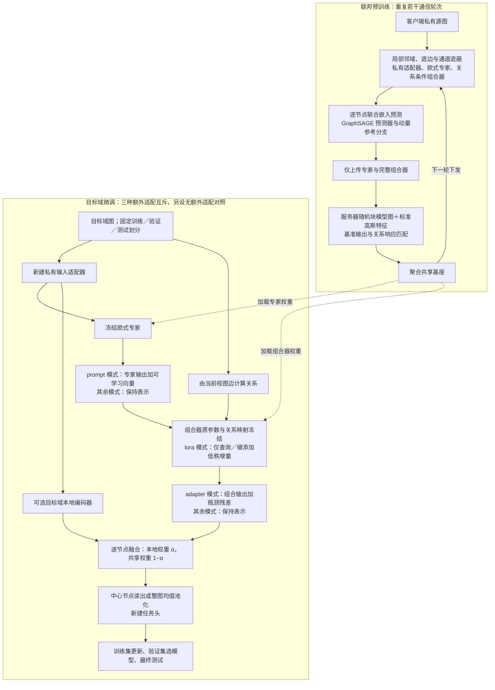

# FedG2C：关系条件专家组合学习

更新：2026-10-09。基于完整复制的 Gefra，保留专家思想，新增不使用几何模块的训练路径。三个模块的代码与合成接口检查已接通；真实任务上的组合泛化效果尚待实验。原始 `README.md` 仍介绍 Gefra，本文件是 FedG2C 新路径的总览。

## 1. 研究目的与模块职责

核心问题是：**如何让多个客户端学到的专家组合能力，在聚合后仍然可用，并迁移到未见组合及不同下游任务？** 我们把这个问题分为本地学习、服务器保留、目标域使用三部分。联合嵌入预测提供无监督训练信号；关系条件组合器负责融合专家；服务器以合成图探针检查关系响应；下游冻结共享基座，以少量新参数适配任务。

| 模块 | 要解决的问题 | 输入 → 输出 | 设计文档 |
|---|---|---|---|
| A：关系条件专家组合学习 | 客户端如何从局部图学到可迁移表示和组合规则 | 本地图、当前共享参数 → 更新后的专家与组合器 | [01_本地预训练_关系条件专家组合学习.md](01_本地预训练_关系条件专家组合学习.md) |
| B：服务器关系响应保持聚合 | 参数聚合如何减少对组合器响应的破坏 | 本轮共享模型、合成图探针 → 聚合共享基座 | [02_服务器聚合_关系响应保持.md](02_服务器聚合_关系响应保持.md) |
| C：下游组合适配 | 冻结基座如何服务目标域任务，并检验迁移收益 | 聚合基座、目标域训练划分 → 目标任务模型与评估 | [03_下游微调_组合适配.md](03_下游微调_组合适配.md) |

以上四个文档分别介绍总体设计与三个已实现模块。每个模块文档说明目的、依据、数据流、伪代码、具体接入函数、启动方式与验证边界；代码命名约定统一在本总览说明。

## 2. A/B/C 代码命名与保留原则

新增或扩展的自有 Python 代码按责任使用以下区块，便于逐模块审阅：

```python
# ===== FedG2C ADD BEGIN A：本地关系条件专家组合学习 =====
# 本地预训练相关新增代码
# ===== FedG2C ADD END A =====

# ===== FedG2C ADD BEGIN B：服务器关系响应保持聚合 =====
# 探针、关系响应、聚合与联邦轮次相关新增代码
# ===== FedG2C ADD END B =====

# ===== FedG2C ADD BEGIN C：下游组合适配 =====
# 下游适配、标签划分、训练评估相关新增代码
# ===== FedG2C ADD END C =====
```

跨模块接点按新增责任标记。例如 `edge_entry.py` 的本地训练属于 A，其上传指纹与轮次补充属于 B。原 Gefra 的运行实现通过独立入口或开关保留；本分享目录已移除验证资料、测试目录和合成运行产物。后续需要替换原行为时，应增加带标记的实现及选择分支，并在接点注释中写清对应关系。

原样第三方代码不加标记，保留许可证、固定提交和文件哈希。`third_party_references/` 是查阅快照；模块三的 `fedg2c/vendor/loralib/` 是原样引入的官方运行依赖，属于明确例外。JSON 配置不支持注释，由文件用途和对应模块文档说明。文档中的工程路径均以 `FedG2C/` 为根，不写本机工作目录。

## 3. 总体数据流与共享边界



共享基座只含 `experts.*` 与 `composer.*`。源域输入适配器、本地预测器、动量分支及预测器位置投影均不传给目标域。服务器探针与参考响应不是下游组件。下游重新建立私有输入适配器和任务头，可处理连续／类别特征、可选边属性，以及节点分类和分子／非分子图分类。

默认下游仅使用共享分支；本地编码器开关用来检查额外目标域学习的影响。三种适配方式是独立实验，按图中各自位置启用；`none` 不添加三者中的任何一个。固定 α=1 时直接跳过共享分支，仅运行本地编码器。详细流程以模块三为准。下游阶段不增加联邦通信。联邦运行消息沿用 Gefra 的命名参数列表与 `num_samples/weight` 字典；阶段／版本属于磁盘检查点格式，不是新增的通信协议要求。

## 4. 代码入口与运行顺序

在 `FedG2C/` 根目录执行，输出目录使用新名称。

```bash
# 仅模块 A：两个合成客户端
python pretrain_fedg2c.py --use-new-design --smoke --max-steps 3 \
  --output runs/local_001

# A＋B：两轮单进程联邦模拟
python pretrain_federated_fedg2c.py --smoke \
  --server-config config/fedg2c_server_response.json \
  --aggregation response --rounds 2 --local-steps 3 \
  --output runs/federated_001

# C：加载第 2 轮聚合产物；这里只是合成下游接口检查
python finetune_fedg2c.py --use-new-design \
  --checkpoint runs/federated_001/round_001/server/shared_backbone.pt \
  --smoke --smoke-level graph --adaptation lora --epochs 2 \
  --output runs/target_001

```

`pretrain_fedg2c.py` 与 `finetune_fedg2c.py` 不传 `--use-new-design`，或显式传 `--no-use-new-design`，均进入原 Gefra。新增联邦入口本身即为新设计；其聚合开关为 `fedavg`、`output_only`、`response`。下游 `--adaptation none` 仅关闭额外适配，保留目标域输入适配器和任务头的训练；`--local-alpha` 控制本地编码器权重。

真实源数据使用 `--source-manifest`；真实目标数据使用 `--target-manifest`。它们分别描述输入文件与可用划分，不是模型模块。新共享检查点必须经新加载器读取，不能交给旧几何加载器。

## 5. 依据、贡献与验证边界

| 部分 | 已有依据及复用 | 本项目需检验的设计 |
|---|---|---|
| 本地学习 | I-JEPA、BGRL、GraphGPS、GraphSAGE；超网络线性注意力机制 | 图局部预测与关系条件专家组合能否改善组合泛化 |
| 服务器聚合 | FED-PUB 合成代理图、FedLAW 聚合权重学习、GAD 有限差分响应匹配机制（原方法扰动扩散噪声） | 在参数凸组合约束下匹配组合器关系响应是否有益 |
| 下游适配 | 官方 LoRA 实现；AdapterGNN 瓶颈机制；GPF 加性提示机制 | 冻结共享基座后迁移收益能否保留、是否依赖特定适配方式 |

各模块文档给出论文、公开代码、固定提交、实际函数和改写范围。模块三以成熟方法作对照和验证接口，不把三种已有技术分别包装成新的算法贡献。

新路径依赖 PyTorch、PyG 及其运行依赖；此前使用 Python 3.12.14、PyTorch 2.12.1、PyG 2.7.0 在 CPU 上运行。真实组合留出、多随机种子、预算控制及节点／图任务实验仍需完成，合成运行不能作为组合泛化效果证据。

## 6. 分享目录说明

目录保留运行代码、配置、四份主设计文档、历史设计与论文代码来源。验证报告、自动化测试、历史合成产物和缓存已移除。示例中的 `runs/` 是执行命令后创建的输出目录，不附带预训练权重或真实数据；先完成本地／联邦预训练，再将产生的检查点交给聚合或微调入口。
