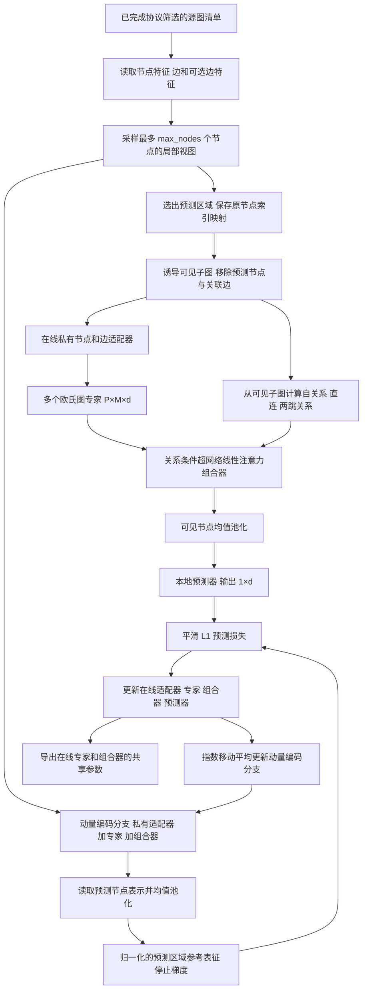

# 历史版本：区域池化原型，非当前推荐路径

保留用于追溯。当前设计见 [逐节点预测版本](../../01_本地预训练_关系条件专家组合学习.md)。本文件中 Graph-JEPA、区域均值预测、在线等旧表述不再作为当前设计依据。

# FedG2C 第一阶段：本地预训练中的关系条件专家组合学习

日期：2026-10-08。本阶段已增加可执行模块与独立入口；当前训练入口执行各客户端的一次本地训练过程并保存结果，不执行联邦轮次聚合。此文记录实际代码与首版选择，研究收益仍需真实数据实验验证。

## 1. 总体思路、目的与意义

我们希望共享图基础模型不仅保留多个专家的表示能力，还能迁移“如何依据局部关系组合专家”的能力。客户端只见到有限的因素组合，直接在完整图上重构或预测可能利用局部共现捷径。因此，本阶段先从允许的源图中选取预测区域，在消息传递前将其从在线输入移除；多个欧氏专家编码可见上下文，组合器利用可见关系产生条件编码，经过非线性交互得到组合表示；本地预测器用这些表示预测预测区域的潜表征。潜表征由动量编码分支提供。

**主要学习对象是共享专家与关系条件组合器。** 联合嵌入预测提供训练信号，动量编码分支用于平滑参考表征。它们不自动保证因素解耦或组合泛化。应通过关系开关、组合方式、训练目标和留出组合性能检验必要性。

首版明确选择**单个预测区域的池化表征预测**：每个训练视图包含一个预测区域，预测器输出一个 `d` 维向量。它不是逐个隐藏节点的定位预测，不需要把完整图位置编码或原节点 ID 送入预测器。共享编码仍输出逐节点表示，因此后续可以连接节点分类或图分类。该较简洁的训练头是否足够需要实验，不能描述成完整复现图像联合嵌入预测的多区域位置查询机制。

## 2. 复制和修改原则

项目复制自 `FedGFM2oE-develop_post`，新目录为 `FedG2C`。

- 原 Gefra 运行实现保留；分享目录不包含复制校验清单与自动化测试。
- 所有新增 Python 文件用 `# ===== FedG2C ADD BEGIN ... =====` 与 `# ===== FedG2C ADD END =====` 标记完整新增区块。Python 无独立块注释语法，此处用成对行注释表达区块边界。
- 新实现放在 `fedg2c/`；旧 `flcore/client.py`、`model/pretraining.py` 等保持不变。通过入口分流选择旧／新路径，不把旧代码注释失效后替换。
- 原客户端与 `model/experts.py` 顶层导入几何模块，因此新路径不继承原 `Client`，而是保留其 `set_pretrain_model → pretrain → get_pretrain_model` 生命周期并直接复用 `GraphEncoder`。
- 第二阶段服务器响应聚合、第三阶段下游适应分别见同目录的 02、03 文档。本次只说明其接口边界，不实现或伪装启用。

## 3. 数据流



### 3.1 输入、关系与输出

| 对象 | 当前实现 | 边界 |
|---|---|---|
| 源输入 | `GraphView(x, edge_index, edge_attr, original_node_id)` | 不读取 `y`、因素标签、预计算位置编码或全图缓存 |
| 局部视图 | 随机起点的宽度优先区域，节点数不超过 `max_nodes` | 选择区域时按无向邻接遍历，保留的消息边仍按原方向；跨连通分量时重启 |
| 预测区域 | 局部视图中按比例选出的区域；至少 1 个节点并至少留下 1 个上下文节点 | 不先在完整视图编码再清零在线表示 |
| 可见关系 | `[P,P,3]`：同节点、直接有向边、两跳可达 | 只从可见子图计算；三类可以重叠 |
| 专家输出 | `[P,M,d]` | `M` 个图专家全部执行，不是节省计算的稀疏专家选择 |
| 条件编码 | `[H,PM,PM]`，`H` 为注意力头数 | `H` 与专家数 `M` 不同；允许正负数，不是概率 |
| 组合输出 | `[P,d]` | 每个节点的专家 token 结果均值汇总；保留逐节点接口 |
| 预测／参考 | `[1,d]` | 单区域池化预测，参考侧在特征维归一化 |

图与图之间按独立视图调用组合器，没有跨图注意力。当前实现优先正确性和小规模核验，未做多图向量化或大规模邻居采样优化。局部视图上 token 两两交互有二次开销；`max_nodes` 是必要的资源约束，不是整个大图的节点数。

### 3.2 在线分支与动量编码分支

**指数移动平均（Exponential Moving Average，EMA）**在在线优化之后执行：

\[
\bar\theta\leftarrow m\bar\theta+(1-m)\theta.
\]

在线参数包含私有节点／边适配器、共享专家与组合器；动量副本只复制这三部分。预测器不进入副本。动量分支始终为评估模式、参数不求梯度，即使外层模型调用 `train()` 也不会开启其随机丢弃。

调用 `set_pretrain_model()` 时只覆盖在线共享参数，保留客户端私有适配器和预测器，再从当前在线编码分支重新初始化动量副本。副本不上传、不用于下游部署。首版动量系数固定，轮间重置策略与系数可后续消融。

## 4. 计算与伪代码

### 4.1 关系条件组合器

把 `[P,M,d]` 展开为 `PM` 个 token，查询、键和值投影得到 `Q,K,V`。关系偏置在同一节点对的所有专家对之间广播：

\[
S_{hqk}=\langle Q_{qh},K_{kh}\rangle/\sqrt{d_h}+b_h(r_{qk}),
\qquad A=\operatorname{RMS}_h(S).
\]

归一化沿头维进行，掩码位置先置零。随后复用同一条件编码：

\[
U_{qkd}=\operatorname{ReLU}\left(\sum_h A_{hqk}V_{khd}\right),
\qquad O_{qhd}=\sum_k A_{hqk}U_{qkd}.
\]

输出投影、残差和层归一化后，把同一节点的 `M` 个 token 均值汇总。残差、图关系和专家索引布局是当前适配设计；不能把整个层说成原论文的等价图实现。

**路由器是生成 `A` 的查询／键投影、关系偏置、掩码和头维归一化部分。** 值投影及两次收缩执行组合。当前有界子图内使用全交互掩码；不额外复制 Gefra 的 Top-K 门控。

代码保留 `relation_gate` 接口：关系偏置可乘以 `[P,P]` 连续门控。第一阶段默认门控为 1；该接口供第二阶段探针使用，本阶段没有运行响应匹配。

### 4.2 本地训练伪代码

```python
# 一次本地训练调用，各客户端从相同共享初始化开始
online.shared.load(shared_state)
momentum_branch.copy_from(online)  # 含当前私有适配器，不含预测器
for epoch in epochs:
    for allowed_graph in source_manifest:
        for view in bounded_views(allowed_graph):
            prediction_region, visible_context = split_before_message_passing(view)
            h = experts(private_adapter(visible_context))
            r = relations_from_visible_context(visible_context)
            z = composer(h, r)
            prediction = predictor(mean_over_visible_nodes(z))
            with no_grad():
                full_z = momentum_branch(view)
                reference = layer_norm(mean(full_z[prediction_region]))
            loss = smooth_l1(prediction, reference)
            loss.backward()
            clip_grad_norm(online_and_predictor, 5.0)
            optimizer.step()
            update_momentum_after_optimizer()
return online.shared.state_dict()  # experts.* + composer.*
```

当前没有本地编码器融合捷径进入预测器。后续下游可以研究本地编码器融合，但不能借此替代共享分支的预训练学习。

## 5. 按模块说明代码接入与来源

本节文件路径相对于 FedG2C 根目录；函数名均对应已经新增的代码。

| 模块与目的 | 新代码位置、关键函数 | 接入原项目的关系 | 来源及迁移性质 |
|---|---|---|---|
| 配置与独立开关 | [fedg2c/config.py::LocalConfig](../../fedg2c/config.py#L6)；[pretrain_fedg2c.py::main](../../pretrain_fedg2c.py#L10) | 不改旧入口；关闭新设计时分派到 `pretrain_gefra.py` | 项目新增，不来自第三方算法 |
| 可见上下文与预测区域 | [fedg2c/context.py::ContextSampler.sample](../../fedg2c/context.py#L101)、`induced_view` | 在专家编码前产生裁剪输入，取代新路径中的完整图增强后预测流程 | 直接调用 [PyG subgraph](https://pytorch-geometric.readthedocs.io/en/stable/modules/utils.html#torch_geometric.utils.subgraph)；参考 [Graph-JEPA 论文](https://arxiv.org/abs/2309.16014) 的图区域预测思路，未复制其分区或双曲代码 |
| 欧氏专家 | [fedg2c/model.py::SharedBackbone.encode_experts](../../fedg2c/model.py#L70) | 复用 `model/graph_encoders.py::GraphEncoder` 的构造；按原 `EuclideanExperts` 方式建立多个图编码器，直接输出 `[P,M,d]` | 用户自己的 Gefra；不导入 `experts.py` 的几何依赖 |
| 边特征有效传递 | [fedg2c/model.py::EdgePassingGraphEncoder.encode](../../fedg2c/model.py#L44) | 以新子类覆盖调用行为，原 `GraphEncoder.encode` 原样保留 | 用户自己的 `EdgeAwareSAGEConv`；只在支持边属性的层上传递，不把 `edge_attr` 塞进不支持的卷积 |
| 私有输入适配 | [fedg2c/model.py::FeatureAdapter.forward](../../fedg2c/model.py#L25)、`EncodingBranch.forward` | 连接原始源图与共享专家入口 | PyTorch 线性层或逐列类别嵌入；本项目薄接口。类别范围来自显式 schema，不把类别编号默认当连续数 |
| 条件化非线性组合 | [fedg2c/composer.py::head_rms](../../fedg2c/composer.py#L14)、`hypernetwork_contract`、`RelationComposer.forward` | 接在专家之后，取代新路径中的几何投影和 Top-K 加权；输出交给区域预测器 | [Attention as a Hypernetwork，ICLR 2025](https://proceedings.iclr.cc/paper_files/paper/2025/hash/abfa542f546df3c6c35695ec8d5bf4b9-Abstract-Conference.html)，[官方代码](https://github.com/smonsays/hypernetwork-attention)；迁移头维归一化和两次收缩的计算核心 |
| 预测与动量更新 | [fedg2c/model.py::LocalPredictionModel.forward](../../fedg2c/model.py#L146)、`update_momentum`、`reset_momentum` | 本地预测损失直接监督新共享路径；由新客户端在优化后更新副本 | [I-JEPA，CVPR 2023，官方论文与代码入口](https://github.com/facebookresearch/ijepa)，按机制独立实现，无图像模型或上游训练脚本复制 |
| 客户端训练与共享消息 | [fedg2c/client.py::LocalPretrainingClient.pretrain](../../fedg2c/client.py#L26)、`set_pretrain_model`、`get_pretrain_model` | 对应原 `flcore/client.py::Client` 的同名生命周期；独立类避开原几何初始化 | 复用 Gefra 的生命周期设计和 AdamW 本地更新规则，新训练主体为本项目实现 |
| 源数据协议接口 | [fedg2c/data.py::read_manifest](../../fedg2c/data.py#L9)、`iter_graphs` | 接受经过划分／筛选后导出的客户端源图，不自动调用旧 loader 随机划分 | 项目新增；严格组合留出不能由通用随机划分替代 |

### 5.1 从公开代码具体迁移了什么

**超网络线性注意力**固定来源提交：`5dceaa1ebef5187a17a38d477a6b2fee8bc3dc38`。

- [attention.py 的固定版本](https://github.com/smonsays/hypernetwork-attention/blob/5dceaa1ebef5187a17a38d477a6b2fee8bc3dc38/hyla/models/attention.py)：约 109 行的 `rms_head` 分支对应 `head_rms()`；约 409 行的 `mlp_relu` 分支对应 `hypernetwork_contract()`。
- `...hqk,khd→qkd` 与 `...hqk,qkd→qhd` 的计算次序、共享条件编码和中间 ReLU 得到保留；JAX 改为 PyTorch。
- 不迁移语言模型训练器、自回归缓存或分布式系统。新增图关系偏置、专家展开／还原、逐节点读出和残差层。
- 上游为 MIT，许可证放在 `third_party_notices/hypernetwork-attention.LICENSE`。当前有手工计算与梯度核验，尚未完成 JAX 原层与整个 PyTorch 层的同权重端到端等价测试。

**联合嵌入预测**固定参考提交：`52c1ae95d05f743e000e8f10a1f3a79b10cff048`。

- [src/train.py 的固定版本](https://github.com/facebookresearch/ijepa/blob/52c1ae95d05f743e000e8f10a1f3a79b10cff048/src/train.py)：约 295 行的无梯度参考分支、参考层归一化，310 行的平滑 L1，332 行在线优化之后的指数移动平均。
- 对应 `LocalPredictionModel.forward/update_momentum` 与 `LocalPretrainingClient.pretrain`。使用 PyTorch 从机制独立实现，不摘取其代码段；原仓库为 CC BY-NC 4.0，不能视作 MIT 依赖。
- 本实现的图裁剪、单区域池化、预测器和固定动量系数不同于原图像设置，需明确为图场景适配。

**Graph-JEPA**仅作方法参考：[官方仓库](https://github.com/geriskenderi/graph-jepa)，提交 `72df1b7704921001ea012a21f840300fbc792cdd`。其 `core/transform.py` 的 patch 映射和 `core/model.py` 的区域编码提供设计参考；当前以 PyG 子图和显式索引重写薄接口，未迁移其二维双曲预测目标，也未声称复现其完整模型。

## 6. 启动方式与开关

在 FedG2C 根目录运行。新增默认配置为 `config/fedg2c_local.json`，仅供开始验证，不是最优参数。

```bash
# 新本地预训练路径：合成小图执行检查，不下载真实数据
python pretrain_fedg2c.py --use-new-design --smoke \
  --config config/fedg2c_local.json --max-steps 3 --output runs/local_smoke_001

# 正式源图输入：仅使用显式清单列出的图
python pretrain_fedg2c.py --use-new-design \
  --source-manifest /absolute/path/source_manifest.json \
  --config config/fedg2c_local.json --epochs 5 --views-per-graph 4 \
  --device cuda:0 --output runs/local_sources_001

# 原 Gefra：原入口和参数原样运行，仍需其几何等依赖
python pretrain_fedg2c.py --no-use-new-design --tune_dataset cora --round 1

# 查看新入口帮助
python pretrain_fedg2c.py --use-new-design --help
```

`--output` 必须是新目录，防止覆盖实验。入口未提供静默恢复；`local_training_state.pt` 保存模型状态，但不包含优化器或随机数状态，不是完整可续跑 checkpoint。

| 开关 | 对照目的 | 注意 |
|---|---|---|
| `--use-new-design` / `--no-use-new-design` | 选择新增路径或原 Gefra | 原 Gefra 是完整旧联邦入口，新入口仅本地阶段，不能直接拿运行耗时作同范围比较 |
| `--composer hypernetwork_relu` | 条件非线性交互 | 新默认 |
| `--composer hypernetwork_linear` | 移除中间非线性 | 保留两次收缩 |
| `--composer standard_attention` | 标准注意力组合对照 | 使用 softmax；与新模块共享图输入及关系描述 |
| `--composer linear_gate --no-relation-condition` | 逐节点专家加权对照 | 不使用跨节点关系；它不是与其他模式参数量完全一致的模型 |
| `--no-relation-condition` | 检查关系偏置作用 | 专家仍在图上消息传递，不等于移除所有结构信息 |
| `--objective joint_embedding_prediction` | 潜表征预测及动量分支 | 新默认 |
| `--objective masked_feature_prediction` | 移除动量潜表征参考的初步对照 | 预测隐藏区域原始连续特征均值；只支持连续输入，不能用于类别编号回归，也不是旧 Gefra 的拓扑重建目标 |

其他参数通过 JSON `LocalConfig` 字段设置。条件分支关闭或层类型变化后共享 schema 会变化，不跨配置静默加载 checkpoint。首版不设服务器或下游“假开关”，这些阶段尚未实现。

## 7. 源图清单格式与信息边界

```json
{
  "schema_version": 1,
  "protocol_id": "your_audited_source_split_id",
  "clients": [
    {
      "id": "source_0",
      "feature_schema": {"input_dim": 9, "node_cardinalities": [119, 4, 12, 12, 10, 6, 6, 2, 2], "edge_dim": 3, "edge_cardinalities": [5, 6, 2]},
      "graphs": ["allowed_source_graphs.pt"]
    }
  ]
}
```

上述类别数只示范显式字段格式，使用前必须对照数据编码器核实，不能按此示例直接推断任意分子数据集的语义。连续输入只提供 `input_dim`，有连续边特征时提供 `edge_dim`。边特征版要求 `backbone=mysage`；其他骨干遇到边属性会报错，不会悄悄丢弃。

每个 `.pt` 保存单个张量字典或张量字典列表：`x` 为 `[N,F]`，`edge_index` 为长整型 `[2,E]`，可选 `edge_attr` 为 `[E,F_edge]`，可选 `original_node_id` 为 `[N]`。节点图与分子图使用同一接口。加载使用 `weights_only=True`，不需要反序列化 PyG 对象。大集合可以分多个文件，避免把整个数据集一次放入内存。

**清单记录不能代替组合留出审计。** 输入图必须预先按已有 PCBA→HIV 或非分子结构组合协议筛选；代码不根据 `protocol_id` 自动判断其正确性。节点任务仅屏蔽标签不够，应先生成满足可见边界的源子图再列入清单。代码不会自动下载 PCBA、重划官方分割或构造分子因素标签。

当前未接入旧数据集加载器与组合筛选器的自动导出桥接；这是后续真实数据实验准备工作。显式清单使这一未完成步骤可见，避免直接复用旧随机划分造成协议偏差。

## 8. 输出与尚未完成事项

每个客户端输出：

- `shared_backbone.pt`：`experts.*` 与 `composer.*`，以及配置、关系定义、协议标识和源清单哈希。是本地训练后的共享候选，不是已经聚合的全局模型。
- `local_training_state.pt`：含私有适配器、预测器、动量副本的本地模型状态；不得当作联邦上传消息。
- `metrics.json`：损失、梯度范数、上下文和预测节点数、上下文标准差，以及最多 128 个参考样本的标准差诊断。

根目录 `run_metadata.json` 记录共享键、源清单和配置。参考标准差只作塌缩诊断线索，单图或极少样本时不能证明未塌缩。

此文件为历史设计；当前实现与研究边界以项目根目录的三份模块文档为准。新路径依赖 PyTorch 与 PyG 及其运行依赖，无须引入几何库、JAX 或图像训练框架。
